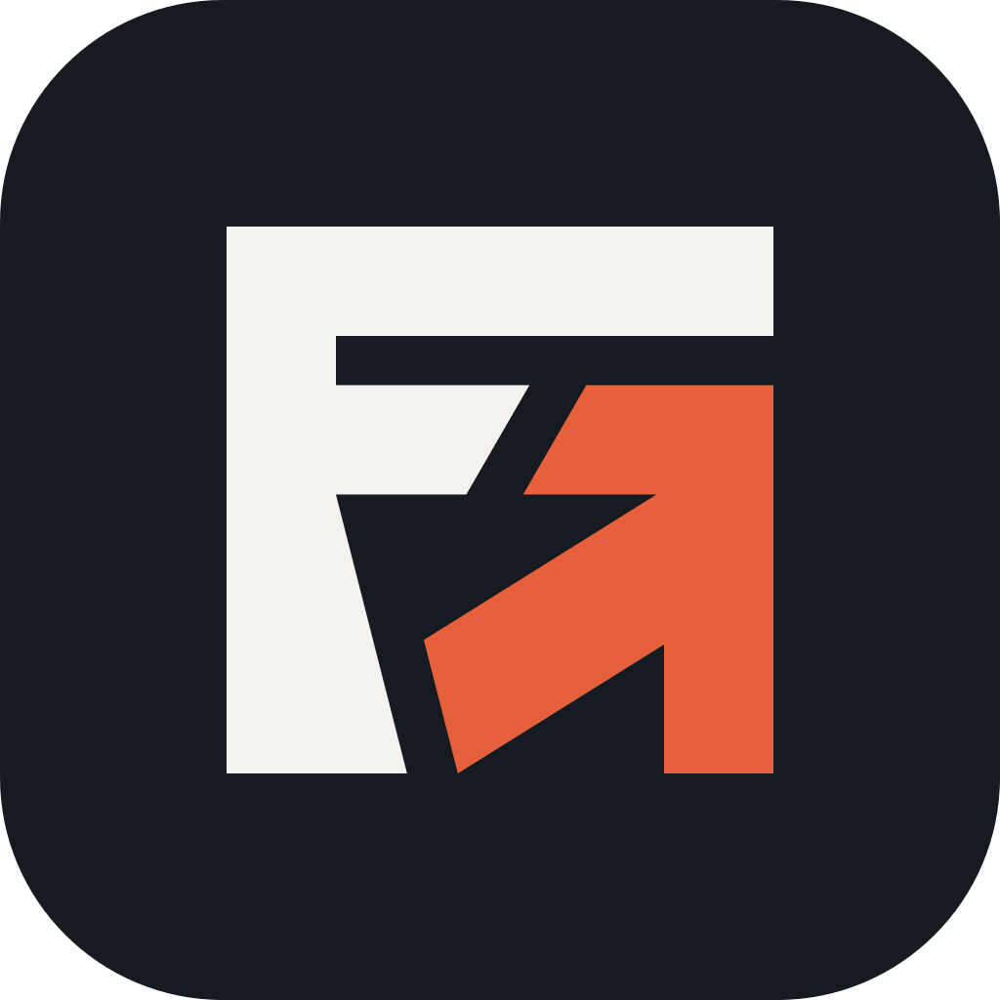

> [!IMPORTANT]
> **Ferrofolio** is an independent, community-driven fork of [Finanze](https://github.com/finanze/finanze).
> It is not affiliated with or endorsed by the Finanze project.
>
> Ferrofolio does not publish its own releases or container images yet; the [Docker](#docker) setup builds the
> images from this repository. See [NOTICE](./NOTICE) for the origin of the code.

<p align="center"></p>
<h1 align="center">Ferrofolio</h1>

<p align="center">
<a href="https://github.com/ferrofolio/ferrofolio">Ferrofolio</a> is an Open Source, private, self-hosted personal finance and portfolio manager that aggregates your assets and investments across banks, brokers, crowdfunding platforms, crypto exchanges & wallets and real estate into a unified application.
It connects to real financial entities via public ways and open banking (PSD2), supports multiple asset types (real estate, crypto, funds, stocks, commodities...) and stores everything in a local encrypted database.
</p>

<h3 align="center">Available As</h3>

<table align="center">
  <tr>
    <td align="center" width="33%"><b>🐳 Docker</b></td>
    <td align="center" width="33%"><b>🌐 Web app (PWA)</b></td>
    <td align="center" width="34%"><b>📱 Mobile apps</b></td>
  </tr>
  <tr>
    <td align="center">
      Self-hosted server,<br>see <a href="#docker">Docker</a>
    </td>
    <td align="center">
      Served by your server,<br>in the browser on desktop and phone
    </td>
    <td align="center">
      Native iOS and Android apps<br>are planned in their own repositories
    </td>
  </tr>
</table>

<h2 align="center"></h2>

<p align="middle">
  
   
   
   
  
   
   
   
</p>

## Table of Contents

- [Features](#features)
- [Usage](#usage)
- [Development](#development)
- [Credits](#credits)

## Features

- 🔄 Fetch financial data from multiple entities
- 💼 Support for various financial products:
    - 📈 Stocks, funds, portfolios, accounts, real estate crowdfunding, cryptocurrencies, etc. from real sources or
      imported
    - 🏠 Real estate investments with a variety of metrics and KPIs
    - 🪙 Commodities with market value tracking
- 💵 Earnings and expenses tracking with periodic asset contributions to forecast future positions
- 📊 Cashflow budgets for needs, wants, and investments, with remaining income and per-label spending breakdowns
- 🤖 AI-assisted transaction labeling with custom rules and model suggestions from cloud, self-hosted, or on-device AI providers
- 🧠 AI file import that extracts positions and transactions from statements, PDFs and images
- 💱 Multicurrency support with automatic exchange rate fetching
- 🔐 Local encrypted database for secure data storage
- 🤖 MCP server for AI clients
- 📤 Dynamic and customizable data export to Google Sheets, CSV, TSV and Excel
- 📥 File importing from CSV, TSV, Excel, HTML and PDF with automatic column detection, plus Google Sheets
- ⚙️ Highly configurable with templating for exports and imports
- 📊 Complex savings & retirement calculator with multiple scenarios and variables

### Cashflow Budgeting

Set monthly targets for needs, wants, and investment contributions, then compare them with actual cashflow. See available or exceeded amounts, track the remaining income over time, and drill into spending by label.

### Transaction Labels, Rules, and AI

Create labels and reusable rules to categorize transactions. Rules can match transaction text, type, amount, currency, dates, entities, or IBANs. Preview matches before applying rules, including to existing transactions. AI providers can suggest labels, and decision-capable models can return confidence scores when supported.

### AI Providers

AI powers transaction labeling and file importing. Connect OpenAI (API key), ChatGPT (Plus or Pro plan), OpenRouter, GitHub Copilot, Anthropic Claude through Claude Code, a custom OpenAI-compatible endpoint, or local models under **Entities > Providers > AI providers**. GitHub Copilot and Claude Code are available on a self-hosted server.

### Local and Self-Hosted Models

- **Local models:** Run GGUF models with a llama.cpp server in router mode, for example the optional
  `ferrofolio-llama` service in the example [docker-compose.yml](docker-compose.yml). Download recommended or
  Hugging Face models or import a GGUF file. With the compose service, imported GGUF files and their `mmproj` files
  must be in `./.storage/models/local`, the folder mounted into the llama.cpp container. Models with a vision projector
  (`mmproj`) can read images and scanned PDFs.
- **Custom AI:** Connect an OpenAI-compatible API such as Ollama, LM Studio, vLLM, or a single-model llama.cpp server with its base URL and optional API key.

External endpoints must be reachable from the Ferrofolio server.

### MCP Server

Ferrofolio includes a Model Context Protocol (MCP) server that lets compatible AI clients access supported Ferrofolio data and tools. In the app, open **Settings > MCP** to enable it, choose an access mode, and copy a connection snippet for your client. Read-only access is enabled by default. Write access allows supported tools to create, edit, and delete data, connect integrations, and fetch entity data.

### Supported Assets by Financial Entity & Crypto Exchanges

| Financial Entity    | Accounts        | Cards | Funds | Stock/<br>ETFs       | Deposits | Portfolios | Loans/<br>Mortgages | Crypto | Bonds | Specific                  |
| ------------------- | --------------- | ----- | ----- | -------------------- | -------- | ---------- | ------------------- | ------ | ----- | ------------------------- |
| Trade Republic      | ✅              | -     | ✅    | ✅                   | -        | -          | -                   | ✅     | ❌    | Private Markets           |
| Unicaja             | ✅              | ✅    | ❌    | ❌                   | ❌       | -          | ✅                  | -      | -     |                           |
| Wecity              | ✅              | -     | -     | -                    | -        | -          | -                   | -      | -     | Investments               |
| Mintos              | ✅ (Smart Cash) | -     | -     | Single ETFs & Stocks | -        | -          | -                   | ❌     | ❌    | Crowdlending              |
| Freedom24           | ✅              | -     | -     | ✅                   | -        | -          | -                   | ❌     | -     | Old structured placements |
| Indexa Capital      | ✅              | -     | ✅️    | -                    | -        | ✅️         | -                   | -      | -     |                           |
| ING                 | ✅              | ✅    | ✅️    | ✅                   | ❌       | -          | ❌                  | -      | -     |                           |
| Grupo Cajamar       | ✅              | ✅    | ❌️    | ❌                   | ❌       | -          | ✅                  | -      | -     |                           |
| DEGIRO              | ✅              | -     | ✅️    | ✅️                   | -        | -          | -                   | -      | -     |                           |
| Interactive Brokers | ✅              | -     | ❌    | ✅️ Stocks            | -        | -          | -                   | -      | ❌    |                           |
| Crescenta           | -               | -     | ✅    | -                    | -        | -          | -                   | -      | -     |                           |
| Trading 212 (Beta)  | ✅              | -     | -     | ✅                   | -        | -          | -                   | ❌     | -     |                           |

| Crypto Exchange | Crypto            | Specific |
| --------------- | ----------------- | -------- |
| Binance         | ✅ Spot & Futures | Futures  |

#### Enable Banking Integration

Provides a way to connect to EU banks that are not natively supported by the app, via PSD2 compliant bank account information.
Instructions to set it up can be found in the app Settings/Integrations tab.

#### GoCardless Integration

Only if you already have an account, another option is GoCardless, which also provides PSD2 compliant bank account information for many EU/UK banks.

### Financial Entity & Crypto Exchanges Features

Not all entities support the same features, in general we can group data in the following categories:

- **Global Position**: current financial position including the current state of assets mentioned above, this is
  supported by all entities.
- **Periodic Contributions**: automatic periodic contributions made to investments such as Stocks/ETFs (Trade
  Republic).
- **Transactions**: all the account/investment related transactions, interest payments, stock of fund operations, asset
  maturity, fees...
- **Investment Historic**: aggregates past positions and TXs to create a history of past and current investments (
  deposits are not included here).

| Financial Entity    | Global Position | Periodic<br>Contributions | Transactions<br>(inv. related) | Investment<br>Historic |
| ------------------- | --------------- | ------------------------- | ------------------------------ | ---------------------- |
| Trade Republic      | ✅              | ✅                        | ✅                             | -                      |
| Unicaja             | ✅              | ✅                        | ❌                             | -                      |
| Wecity              | ✅              | -                         | ✅                             | ✅                     |
| Mintos              | ✅              | -                         | Single ETFs & Stocks           | ❌                     |
| Freedom24           | ✅              | -                         | ✅                             | ❌                     |
| Indexa Capital      | ✅              | -                         | ✅                             | -                      |
| ING                 | ✅              | ✅                        | ✅                             | -                      |
| Grupo Cajamar       | ✅              | -                         | ❌                             | -                      |
| DEGIRO              | ✅              | ❌                        | ✅                             | -                      |
| Interactive Brokers | ✅              | ❌                        | ✅⚠️                           | -                      |
| Crescenta           | ✅              | -                         | ✅                             | -                      |
| Trading 212 (Beta)  | ✅              | ❌                        | ✅                             | -                      |

| Crypto Exchange | Global Position | Periodic<br>Contributions | Transactions<br>(inv. related) | Investment<br>Historic |
| --------------- | --------------- | ------------------------- | ------------------------------ | ---------------------- |
| Binance         | ✅ Spot         | ❌                        | ✅️                             | -                      |

### Financial Entity notes

Some entities require a 2FA to login or get its data, which doesn't allow to background update, this applies to the
following ones:

- **Trade Republic** (mobile app or SMS)
- **Wecity** (SMS)
- **DEGIRO** (mobile app confirmation)

Important points to remark:

- **Unicaja** requires setting the `UNICAJA_ABCK` environment variable to log in, as it uses Akamai for antibot
  protection.
- **Mintos** needs Selenium to resolve reCAPTCHA.
- **Trade Republic**, **ING** and **IBKR** cannot log in on a Ferrofolio server yet. Their login needs a browser
  window that only the upstream desktop app opens, and Ferrofolio does not ship a desktop app. A server-side login
  for Trade Republic is planned, see the [roadmap](docs/roadmap.md).
- **Freedom24** D-Account interest (swaps) txs were supported and its related transactions, but not anymore since its
  removal.

### Crypto

Crypto is a bit special, as it is not a financial entity, but a financial product. To add it just set up a wallet,
currently the following are supported:

- **Bitcoin** (xpub supported)
- **Ethereum**: ERC20 tokens are supported too.
- **Litecoin** (xpub supported)
- **Tron**: TRC20 tokens are supported too.
- **Binance Smart Chain**: BSC tokens are supported too (requires Etherscan integration setup with an API Key).

At the moment the only available feature for crypto is **Global Position**, transactions are WIP.

Some financial entities such as Trade Republic support crypto too.

#### Zerion

Zerion is also supported (by providing your free API key), which allows to multiple crypto asset tracking and DeFi.

#### Other entity types

This app also is capable of tracking market forecast platforms such as Polymarket, tracking transactions, PnL and current & historic positions (not manual data).

### Commodities

Manual commodity input is feature that allows to track market value for them. Currently, the following are supported:

- **Gold**
- **Silver**
- **Platinum**
- **Palladium**

### Export and Importing

Positions and transactions can be imported and exported in several ways:

- **Files**: export to CSV, TSV and Excel. Import from CSV, TSV, Excel (XLS/XLSX), HTML tables and text-based PDFs.
  Columns are detected automatically, or mapped manually or with a saved template, with a preview before saving.
- **AI import**: extracts data without templates from the file formats above, plain text and images (PNG, JPEG, WebP,
  GIF, plus HEIC on mobile), including scanned PDFs. Supports extra instructions and fallback providers. Images and
  scanned PDFs require a vision-capable model. Results are previewed before saving.
- **Google Sheets**: export and import by connecting a Google account under **Entities > Providers**. Imported
  spreadsheet data is its own source, so each import replaces previous Google Sheets data without affecting real or
  manual data.

#### Templating

Exporting and importing is highly customizable using templates, which allows to define the structure of the tables,
data formatting, filters and other features. Templates are optional for file imports and define Google Sheets imports.

Check [Export & Import Configuration](#export--import-configuration) for more technical info.

## Usage

Ferrofolio runs self-hosted in Docker. The web app is served by its own frontend container, `ferrofolio-front`, next
to the server and is used in the browser, on the desktop as well as on the phone. There is no desktop app. Native
mobile apps are planned in their own repositories, `ferrofolio/ios` first and `ferrofolio/android` later; until they
exist, the web app is the mobile client. Offline caching of the app shell and installation on the home screen are in
progress. See the [roadmap](docs/roadmap.md) for details.

### Docker

Ferrofolio does not publish container images yet. The example [docker-compose.yml](docker-compose.yml) builds the
server image `ghcr.io/ferrofolio/ferrofolio` and the frontend image `ghcr.io/ferrofolio/ferrofolio-frontend` from this
repository:

```sh
docker compose up -d --build
```

When upgrading a setup that used the upstream compose file, its services were named `finanze-server` and
`finanze-front`, and their containers keep ports 7592 and 8080. Remove them before starting the renamed services:

1. Before updating, run `docker compose down` in the directory of the old setup. Compose names a project after the
   directory of its compose file, so the next step does not reach a setup in another directory.
2. In the directory of this repository, start the renamed services and remove containers left from the old ones:

   ```sh
   docker compose up -d --build --remove-orphans
   ```

The server keeps its data in `./.storage` next to the compose file. Run the upgrade in the directory that holds the
existing `./.storage` folder, or copy that folder into the new checkout first: a new checkout starts with an empty
`./.storage`. The old data is not deleted.

Cloud sign-in and cloud backup run on upstream Finanze services (Supabase and `api.finanze.me`). Images built from
this repository are not configured for them, so these features do not work after the upgrade. The local data in
`./.storage` is not affected.

The server image is built without Selenium by default. Mintos needs Selenium and reCAPTCHA resolution related
dependencies (like ffmpeg); set the build argument `SELENIUM_SUPPORT` to `"true"` in the compose file to include them.

Checkout example [docker-compose.yml](docker-compose.yml) for a complete setup.

## Development

This project requires `Python 3.14`.
For the frontend use `pnpm`, and `node 24`.

### Setup

1. Clone the repository:

    ```sh
    git clone https://github.com/ferrofolio/ferrofolio.git
    cd ferrofolio
    ```

2. Create a virtual environment and activate it (recommended Pyenv for version management):

    ```sh
    python3 -m venv venv
    source venv/bin/activate
    ```

3. Install the required dependencies:

    ```sh
    pip install -r requirements.txt -r requirements-dev.txt -r requirements-lint.txt -r requirements-packaging.txt
    pip install -r requirements-selenium.txt  # If you want to use Selenium for reCAPTCHA, only for Mintos
    pre-commit install
    ```

4. Setup the frontend:

    ```sh
    cd frontend/app
    pnpm install
    cd ../..
    ```

5. Run it. The server stays in the foreground, so start the frontend in a second terminal:

    ```sh
    python ./finanze --port 7592 --data-dir .storage --log-dir .storage/logs --log-level DEBUG --third-party-log-level DEBUG
    ```

    Browser only, connecting to the server running in the first terminal. The default Vite dev URL is
    http://localhost:5173:

    ```sh
    cd ferrofolio/frontend/app   # path of your clone; a new terminal starts outside it
    WEB_ONLY=1 VITE_BASE_URL=http://localhost:7592 pnpm dev
    ```

    Or the Electron desktop app. It starts its own backend on port 7592 with the `python` on your `PATH`, so stop the
    server in the first terminal and activate the virtual environment from step 2 first:

    ```sh
    cd ferrofolio/frontend/app   # path of your clone; a new terminal starts outside it
    source ../../venv/bin/activate
    pnpm dev
    ```

#### Other

##### Formatting

    ```sh
    ruff format

    cd frontend/app
    pnpm format
    ```

##### Executing tests

    ```sh
    pytest              # Backend

    cd frontend/app
    pnpm test           # Frontend

    cd e2e/standard
    pnpm test           # Web based E2E
    ```

### Environment Variables

Checkout example docker-compose.yml for the environment variables that can be used to override the default config, most
important ones are::

- `USERNAME` and `PASSWORD` optional, to auto start session on load.
- `MULTI_USER` optional, to allow multiple user sign up (only recommended for local development).
- `FINANZE_PUBLIC_URL` optional, the address under which the server is reachable from your browser, for example
  `https://finance.example.com`. Bank connections through Enable Banking redirect to
  `<address>/api/v1/entities/external/callback` after you gave consent, and that URL has to be listed as an allowed
  redirect URL in your Enable Banking application. Google Sheets redirects to `<address>/oauth/callback` after you
  authorized access, and that URL has to be listed as an authorized redirect URI of your Google OAuth client. Google
  only accepts such a URI with HTTPS and a domain name under a public top-level domain, with `localhost` and loopback
  addresses as the only exception. A raw IP address such as `https://192.168.1.10` or a local-only name such as
  `https://finance.lan` is rejected even over HTTPS, so for Google Sheets the server has to be reachable over HTTPS
  under such a domain name even inside a trusted local network. The name only has to resolve inside that network.
  Without this variable the address is taken from the request, including the `X-Forwarded-Proto` and
  `X-Forwarded-Host` headers of a reverse proxy. The browser carries the authorization code back to the app, so serve
  the server over HTTPS unless it only runs in a trusted local network; over plain HTTP that code is sent unencrypted.
- `FF_<NAME>` optional, sets a feature flag, for example `FF_TR_V2_AUTH_API=OFF` to use the previous Trade Republic
  sign-in. Feature flags are local configuration; the upstream cloud (`FF_CLOUD`) is off by default. `FF_` variables
  only apply while `FEATURE_FLAG_URL` is unset.
- `FEATURE_FLAG_URL` optional, a remote source for feature flags. When it is set, all flags come from that source and
  `FF_` variables are ignored. It is not set by default, so no request leaves the server for it.
- `CRYPTO_DATASET_URL`, `METAL_RATES_URL` and `CLOUD_URL` optional, sources for a crypto coin snapshot, historic
  metal prices and cloud backups. None is set by default, so the server does not contact upstream services for them.
- Other Selenium related ones.

## License

Ferrofolio is free software licensed under the [GNU Affero General Public License v3.0](./LICENSE) (`AGPL-3.0-only`).

Contributions are accepted under the same license. There is no contributor license agreement: nobody, including
the maintainers, can relicense the project under proprietary terms. See [CONTRIBUTING](.github/CONTRIBUTING.md).

Ferrofolio is derived from [Finanze](https://github.com/finanze/finanze). See [NOTICE](./NOTICE).

## Attributions & Credits

- Powered by [CoinGecko](https://www.coingecko.com/).
- Powered by [CoinMarketCap](https://coinmarketcap.com/).
- Powered by [CryptoCompare](https://www.cryptocompare.com/).
- Llama.cpp icon from [ggml-org/llama.brand](https://github.com/ggml-org/llama.brand), used under
  its [brand usage policy](https://github.com/ggml-org/llama.brand/blob/master/BRAND-USAGE.md) (CC BY-NC 4.0).
- Trade Republic client is based on project [pytr-org/pytr](https://github.com/pytr-org/pytr), although it has been
  heavily modified, this library has been vital for the entity integration.
- Selenium reCAPTCHA resolution is based
  on [sarperavci/GoogleRecaptchaBypass](https://github.com/sarperavci/GoogleRecaptchaBypass/tree/selenium)
  project, using a slightly modified version of Selenium version. In an attempt of using Playwright I made an adaptation
  for it [here](finanze/infrastructure/scrapers/mintos/recaptcha_solver_playwright.py), it works, but has some troubles
  with headless mode.
