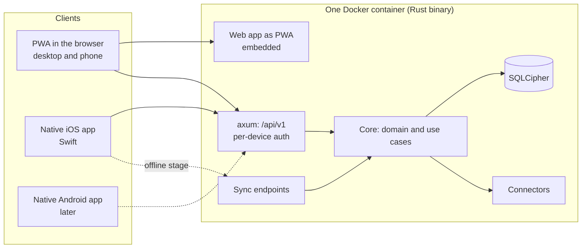
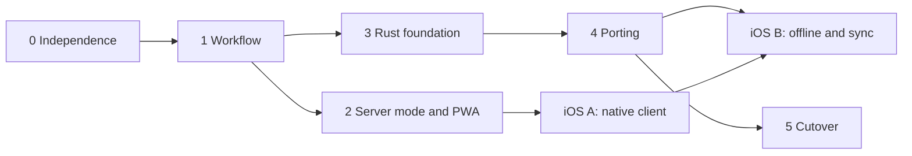

# Ferrofolio roadmap

Rust backend, web app as a PWA, native iOS app, an open licence and an agent-driven workflow.

Last updated: 2026-11-20 · Fork point: Finanze `develop` at `d9761ed6` · Code measurements were taken at `c940caf2`, two commits earlier.

This document holds the plan. Progress is tracked in one GitHub issue per workstream, labelled
[`roadmap`](https://github.com/ferrofolio/ferrofolio/issues?q=is%3Aissue+label%3Aroadmap); a pull request does not
need an issue of its own.

## Status

| Track | State | Tracking |
|---|---|---|
| Phase 0 – Independence | Nearly done: upstream services are off by default and a test fails on new references to `finanze.me`. Left: the data directory and three decisions | [#83](https://github.com/ferrofolio/ferrofolio/issues/83) |
| Phase 1 – Workflow and quality gates | In place, except end-to-end tests (off during the rewrite), secret scanning, workflow lint, and the Rust and Docker jobs as required checks | [#84](https://github.com/ferrofolio/ferrofolio/issues/84) |
| Phase 2 – Server mode and PWA | Capacitor, Pyodide and the desktop app are removed. Open: hardening, PWA, API contract | [#85](https://github.com/ferrofolio/ferrofolio/issues/85), [#86](https://github.com/ferrofolio/ferrofolio/issues/86), [#87](https://github.com/ferrofolio/ferrofolio/issues/87) |
| Phase 3 – Rust foundation | Started ahead of phase 2: the Rust server is the entry point, holds the sessions and opens the database. Open: web app in Rust, end-to-end tests, spikes | [#88](https://github.com/ferrofolio/ferrofolio/issues/88) |
| Phase 4 – Porting | Started: 4 of 118 routes under `/api/v1` are served by Rust | [#91](https://github.com/ferrofolio/ferrofolio/issues/91) |
| Scalable Capital | Not started | [#89](https://github.com/ferrofolio/ferrofolio/issues/89) |
| Trade Republic sign-in on the server | Not started | [#90](https://github.com/ferrofolio/ferrofolio/issues/90) |
| Phase 5, iOS stages A and B, Android | Not started; an issue is opened when the track becomes current | – |

---

## 1. Decisions

| Topic | Decision |
|---|---|
| Name | **Ferrofolio** |
| Distribution | The server runs as a Docker image that users build from this repository; the project does not publish images yet. The web app is served by a separate nginx frontend container (`ferrofolio-front`, built from `frontend/Dockerfile`) and becomes a PWA; native mobile apps are planned in their own repositories. Nothing else |
| GitHub | Own organisation `ferrofolio`; server and apps live in separate repositories, one per mobile platform |
| Registry | `ghcr.io/ferrofolio/ferrofolio` |
| Bundle IDs | `app.ferrofolio.ios`, later `app.ferrofolio.android`, based on the project domain `ferrofolio.app` (registered) |
| Licence | AGPL-3.0 stays, the CLA is dropped; contributions come in under the project licence |
| Language | Everything in the project is written in English |
| Backend | Rewritten in Rust, incrementally |
| Web app | Stays in the Docker container and becomes a PWA |
| Mobile | Native apps instead of Capacitor; **iOS first**, Android later |
| Scope of the iOS app | Everyday tasks only; administration stays in the web app |
| iOS distribution | Not in the App Store for now and without a paid Apple Developer account; installed by sideloading through AltStore Classic (section 4.8) |
| Desktop app | Dropped; the PWA covers the desktop |
| Transition | Until the iOS app exists, the PWA is the mobile client |
| Dependency updates | Dependabot instead of a third-party app: it is part of GitHub and needs no additional write access to the repositories |
| Bank connectivity | Enable Banking is proven with German banks in Docker operation and is the reference connector |
| Scalable Capital | New connector as a goal of its own, prioritised **before Trade Republic** (section 4.6) |
| Trade Republic | Must keep working, also without the desktop app (section 4.7) |
| Tracking | One GitHub issue per workstream with the label `roadmap`, not one per task |

---

## 2. Starting point

This section describes the code at the fork point; the [status](#status) shows what has changed since.

| Area | Size | Note |
|---|---|---|
| Python backend `finanze/` | ~105,000 lines | `domain` 11.7k · `application` 22.8k · `infrastructure` 70.3k |
| of which bank and broker connectors | ~20,600 lines | 17 financial entities, 2 exchanges, 6 crypto chains |
| of which Enable Banking and PSD2 | ~1,100 lines | Official interface, no scraping |
| HTTP API | 119 routes under `/api/v1` | Quart and uvicorn, 121 use cases, 85 ports |
| Database | SQLCipher, 13 migrations | Encrypted with the user's password |
| Python tests | ~101,700 lines, 286 test files | 39 controller integration tests |
| Frontend `frontend/app` | ~160,000 lines of TS/TSX | React 19, Vite, Electron, Capacitor |
| of which Capacitor, Pyodide, native shells | ~16,600 lines | Removed by the decision for native apps |
| of which Electron desktop | ~3,700 lines, plus 73 call sites in UI code | Removed by dropping the desktop app |
| End-to-end tests | 47 specs | Playwright (web), WebdriverIO (mobile) |

Five findings shape this roadmap:

1. **The architecture is hexagonal** (`domain` / `application/ports` / `infrastructure`). It maps almost one-to-one onto Rust crates and traits and can be ported in small slices.
2. **The existing mobile apps have no server backend.** They run the complete Python backend through Pyodide inside the web view (`frontend/app/src/services/apiClient.ts`). This approach is not continued.
3. **Per-client API sessions exist, but the server is not yet hardened for the internet.** Since upstream change #238 a session guard requires a bearer token on every request, except for a short list of public paths (status, login and the OAuth and bank callbacks), `OPTIONS` requests and static files (`finanze/infrastructure/controller/api_session_guard.py`). The guard is on by default and is not registered at all when `FINANZE_API_SESSION` is set to `false`. What is still missing: CORS is fully open (`finanze/infrastructure/controller/config.py`), the login has no rate limit, sessions cannot be listed or revoked per device, and the web client keeps its token in browser storage.
4. **The code depends on upstream services**: `api.finanze.me` (backup), Supabase (cloud login), `features.api.finanze.me` (feature flags), `static.finanze.me` (ticker icons), telemetry DSNs, the Docker Hub images `finanze/finanze*` and the bundle ID `me.finanze`.
5. **Enable Banking also runs through upstream.** The redirect after bank consent is hard-coded to `https://finanze.me/eb/v1/entity/callback/` (`finanze/infrastructure/client/financial/enablebanking/enablebanking_client.py`). Existing connections therefore depend on the upstream website today. The same holds for Google Sheets (`finanze/infrastructure/sheets/sheets_service_loader.py`).

About the PWA: a web manifest with `display: standalone` and the iOS meta tags already exist. A service worker is missing.

---

## 3. Licence and governance

**Keep AGPL-3.0 and drop the CLA.** Contributions are accepted under the project licence ("inbound = outbound"), without a contributor agreement and without a sign-off requirement.

- Upstream has been licensed under **AGPLv3** since commit `843fd04c` (2026-08-17). That is a genuine, OSI-approved open-source licence. The concern is the upstream **CLA**: it grants the upstream maintainer the right to relicense contributions under any terms, explicitly including proprietary ones.
- The fork **cannot change the licence**, because the copyright in the existing code belongs to the upstream authors. The Rust port stays under AGPL as well: a translation of the Python code is a derivative work.
- This is the protection the project wants. Without a CLA **nobody**, including the Ferrofolio maintainers, holds the right to take the project proprietary later.

| Step | Content | Status |
|---|---|---|
| Remove `CLA.md` | And the CLA section in `.github/CONTRIBUTING.md` | Done |
| README licence section | Remove the paragraph offering a commercial licence; only upstream can make that offer | Done |
| Copyright notices | Keep the upstream copyright; add a `NOTICE` file with the origin (upstream repository, fork commit) and a statement of modification (AGPL section 5) | Done |
| Source link in the web UI | Link to the Ferrofolio repository in the "About" dialog (AGPL section 13, network use) | Done (#24) |
| New files | SPDX header `AGPL-3.0-only` | Ongoing rule |
| `cargo deny` | Licence check of all Rust dependencies for AGPL compatibility as a CI gate | Done (#65) |

**Trademark.** The AGPL grants no trademark rights. The name, icons and identifiers of "Finanze" are planned to be replaced. The name "Ferrofolio" has been checked against GitHub, crates.io, npm, Docker Hub and domain registries, and the domain `ferrofolio.app` is registered for the project. A check against trademark registers is not planned.

**Direction of code flow.** Ferrofolio may take upstream changes (AGPL to AGPL). Upstream cannot take Ferrofolio code unless its authors sign the upstream CLA.

**AGPL and the App Store.** The iOS app is distributed by sideloading only for now (section 4.8). The App Store terms do not apply to that, so the question does not arise. It becomes relevant only if the app is later meant for the App Store or for a marketplace that requires Apple notarisation. Whether (A)GPL code is compatible with the App Store terms is disputed.

- The native iOS app is new code written for this project. Its authors may distribute it through the App Store. So that this also holds for third-party contributions, the iOS repository carries an explicit additional permission for app-store distribution from the start (AGPL section 7).
- Once the app contains the Rust core (iOS stage B), it contains AGPL code derived from upstream. Ferrofolio cannot grant that permission for upstream's code. Before any move to the App Store this would need to be settled, for example by asking upstream for permission.

> This is a technical assessment, not legal advice.

### 3.1 GitHub organisation and repositories

A GitHub fork stays technically tied to upstream (pull requests target upstream by default, no code search, restricted settings). The repositories are therefore created fresh; `upstream` remains a fetch-only remote in the server repository.

| Repository | Content | Origin |
|---|---|---|
| `ferrofolio/ferrofolio` | Rust workspace, Python backend until cutover, web app (PWA), Docker, API contract (OpenAPI) | Complete existing history |
| `ferrofolio/ios` | Native iOS app in Swift | New |
| `ferrofolio/android` | Native Android app in Kotlin | Later, once someone can test it |
| `ferrofolio/.github` | Shared files: CONTRIBUTING, SECURITY, issue templates, reusable workflows | New |

So far only `ferrofolio/ferrofolio` exists; the others are created when their work starts.

With native apps the split is clean. Server and apps share **no UI code**, only two things:

- the **API contract** (OpenAPI), from which the Swift client is generated
- later the **Rust core** as a prebuilt binary package for offline use

**Rules against version drift.** Server and app are updated independently.

- Only additive changes within `/api/v1`
- `GET /api/v1/status` reports the server version and capabilities; the app detects a server that is too old and says so clearly
- The iOS repository tests in CI against the current `next` build of the server

**Organisation settings** (done in the browser; GitHub offers no API for creating organisations):

| Setting | Value |
|---|---|
| Plan | Free, all repositories public |
| Two-factor requirement | On |
| Base permission for members | Read |
| Organisation-level rulesets | Pull request required, required checks, no direct push to `develop` or `main` |
| Organisation-wide apps | CodeRabbit |
| Secrets | Registry access organisation-wide; none for `ios` for now, because it is built unsigned |

---

## 4. Target architecture

**One container instead of two.** Today: the server container, in which the Rust binary serves the ported routes and forwards the rest to Python, plus an nginx frontend. Target: one statically linked Rust binary that serves the API, the web app and sync.

**The React frontend stays** and becomes a PWA. The `/api/v1` contract stays stable, which turns the existing Playwright specs into the acceptance test for the Rust backend.

### 4.1 Rust workspace

| Crate | Corresponds to | Content |
|---|---|---|
| `core-domain` | `finanze/domain` | Types, errors, `Dezimal` with the arithmetic of Python's `decimal` (28 significant digits; `rust_decimal`'s bounded scale proved unable to reproduce Python's results, see `docs/rust-backend.md`) |
| `core-app` | `finanze/application` | Use cases, ports as traits |
| `infra-db` | `infrastructure/repository` | `rusqlite` with SQLCipher, migrations |
| `infra-http` | `infrastructure/client/http` | HTTP client |
| `connectors-*` | `infrastructure/client/entity` | One crate or feature flag per connector |
| `infra-import` | `templating`, `table`, `ai_import` | XLSX, CSV, PDF |
| `infra-ai` | `client/ai`, `local_models`, `labeling` | AI providers |
| `server` | `infrastructure/controller`, `server.py` | axum, auth, static files |
| `sync` | `infrastructure/cloud` | Sync protocol, server and client side |
| `mcp` | `infrastructure/mcp` | MCP server |
| `ffi` | – | UniFFI bindings for Swift and Kotlin |

`core-domain`, `core-app`, `infra-db` and `server` exist; every other crate is created with the slice that needs it.
Domain types move into `core-domain` as ported routes need them, not ahead of them.

### 4.2 Dependency mapping

Crate names reflect the state of knowledge when this roadmap was written and are verified by spikes in phase 3.

| Python | Rust | Risk |
|---|---|---|
| quart, uvicorn, quart-cors | axum, tokio, tower-http | Low |
| pydantic | serde, validator/garde | Low |
| sqlcipher3 | rusqlite (`bundled-sqlcipher`) | Low; `sqlx` does not support SQLCipher cleanly |
| cryptography (Fernet, PBKDF2), PyJWT | fernet, RustCrypto, jsonwebtoken | Low; Enable Banking signs requests with a JWT |
| httpx | reqwest | Low |
| httpx-curl-cffi (TLS impersonation) | wreq/rquest (BoringSSL) | Medium; only needed for scraping connectors |
| websockets (Trade Republic) | tokio-tungstenite | Low |
| beautifulsoup4 | scraper | Low |
| openpyxl, xlrd | calamine (read), rust_xlsxwriter (write) | Low |
| pypdf, pypdfium2, Pillow | pdfium-render, lopdf, image | Medium |
| yfinance, nordigen | Own REST client | Medium |
| degiro-connector | Own port, no Rust equivalent | High |
| mcp | rmcp (official Rust SDK) | Low |
| google-api-python-client | Own REST client for Sheets | Medium |
| base58, ecdsa | bs58, k256, bitcoin/bip32 | Low |
| selenium (Mintos) | fantoccini/thirtyfour, or drop | Medium |
| Agent SDKs without a Rust equivalent | Connect over HTTP or CLI, or drop | High |
| sentry-sdk | sentry crate, or remove telemetry | Low |
| aiocache, cachetools | moka | Low |

### 4.3 Clients

| | PWA | Native iOS app | Native Android app |
|---|---|---|---|
| Role | Web app for desktop and phone; the mobile client until the iOS app exists | Main client on the phone | Later |
| Technology | Existing React frontend plus a service worker | Swift, SwiftUI | Kotlin, Compose |
| Data | Always from the server | From the server first, later also offline | Same as iOS |
| Repository | `ferrofolio/ferrofolio` | `ferrofolio/ios` | `ferrofolio/android` |

**PWA.** The web app stays complete; PWA capability is added.

- A service worker that caches only the app shell. API responses containing financial data are **not** stored in the browser for now.
- Installable on the iOS home screen; this needs HTTPS, which server operation needs anyway.
- A prompt to reload when a new version is available, instead of a silent update.
- The mobile layout must depend on screen width, not on the native shell. The 80 call sites of `isNativeMobile()` and 34 of `__MOBILE__` are gone with Capacitor and the desktop app; what remains is to check every view at phone width.
- Limits on iOS: no Face ID without passkeys, no background sync, storage can be cleared by the system. Because the data lives on the server, this is not critical.

**Capacitor and Pyodide are removed** (done, #38 to #42, #44, #45 and #49). With the decision for native apps, `src/lib/pyodide`, `src/lib/capacitor`, `src/lib/mobile`, `src/python`, the folders `ios`, `android` and `native`, the Python bundling, the mobile end-to-end tests and their workflows all went. That is about 16,600 lines and 19 dependencies fewer.

**The desktop app is removed** (done, #55). This dropped the `electron` folder (about 3,700 lines), the 73 Electron branches in UI code, the PyInstaller packaging (`package.py`, `package_llama.py`, `finanze.spec`), the auto-updater and the build matrix for three operating systems including signing. The frontend now knows exactly one environment, the browser, and the server ships only as a container.

One consequence: five connectors signed in to the bank through their own Electron windows, namely IBKR, ING, Mintos, Trade Republic and Unicaja (`frontend/app/electron/main/loginHandlers`, last at `890f604e`). According to the upstream README, Trade Republic, ING and IBKR therefore do not work in Docker operation at all today. A replacement path exists for Trade Republic (section 4.7); the other four have not been investigated. Enable Banking is not affected.

**Ferrofolio does not build or ship the desktop app, and its code has been removed from the repository.** The Electron login windows remain in the Git history (last at `890f604e`) and in upstream Finanze as a reference for the server-side sign-in.

This leaves a known gap. Until the server-side sign-in exists (phase 4, slice 4), no Ferrofolio build offers Trade Republic sign-in, just as the upstream Docker image does not today. In the interim the connector can only be used through the upstream desktop app. The gap is accepted because Scalable Capital has priority. The server-side sign-in is still Python work with no dependency on the Rust foundation, so it can be pulled forward into phase 2 if the gap becomes a problem (#90).

**Native iOS app.**

- The API client is generated from the server's OpenAPI specification, so a contract change shows up at compile time.
- Token in the keychain, unlocking with Face ID.
- Bank consent runs through the system sign-in sheet with a return into the app.
- **The app does not rebuild all 119 routes.** It covers everyday use: net worth overview, positions, transactions, cash flow, manual entries, triggering a fetch. Rare administrative tasks (imports, templates, setting up integrations) stay in the web app.
- What only a native app can do and is worth doing: widgets, local notifications, later offline use.

Prerequisite: a **Mac with Xcode**. An iOS app cannot be built or run in the simulator on Linux. A paid Apple Developer account is not needed for now (section 4.8).

**Offline use and sync** reach the iOS app only with the Rust core (iOS stage B). It starts with the simple variant: an encrypted full reconciliation of the database, with conflicts reported. The existing backup code is the template for it, but no longer a constraint, because no old client has to stay compatible. Record-level sync comes only if the simple variant proves insufficient in daily use.

### 4.4 Server security

Per-client API sessions with bearer tokens already exist (upstream change #238). Since #76 the Rust server holds them and keeps Python's session guard as a second line of defence ([rust-backend.md](rust-backend.md#sessions)), so the hardening below is built in Rust. Required before any device connects from outside (#85):

- Sessions per device: a session cookie (HttpOnly, Secure, SameSite) for the web app, tokens for native apps; a device list and per-device revocation
- Rate limit and lockout on the login
- CORS restricted to configured origins
- TLS through a reverse proxy, documented with a Compose example (Caddy or Traefik)
- The MCP endpoint uses the same auth path

To be decided: **one user per instance** (recommended for v1, matches today's model) or real multi-user support.

A known property that stays: the database is encrypted with the user's password. After a restart the server is locked until someone signs in or `USERNAME` and `PASSWORD` are set in the environment. Scheduled fetches need one of the two.

### 4.5 Enable Banking without upstream

Each user already registers their own Enable Banking application (the application ID and private key are entered in the settings). Only the redirect runs through `finanze.me`.

- The redirect points to the user's own instance, for example `https://<instance>/api/v1/…/callback`.
- That address must be added as an allowed redirect URL in the user's Enable Banking application.
- The instance does not need to be publicly reachable for this, only reachable from the user's browser, because the redirect happens in the browser.
- Status: done (#5). Open banking through Enable Banking is the one connection verified since the fork; the setup guide documents the redirect URL.

### 4.6 Scalable Capital

Tracked in #89. The codebase has no connector for Scalable Capital; it is built new. No browser automation is needed: **Scalable Capital publishes its own command-line client**, [`ScalableCapital/scalable-cli`](https://github.com/ScalableCapital/scalable-cli), written in Rust and licensed under Apache-2.0.

The details below come from the documentation of the open-source project GiroCrab, which built a Scalable connector in Rust on that basis and reports having verified it against a live account on 2026-11-11. They have not been verified independently for this roadmap.

| Aspect | Status |
|---|---|
| Sign-in | Device-code flow: the server shows a link and the user confirms in the Scalable app. No browser in the container, no token interception |
| Account prerequisite | "Agentic Investing" enabled under Profile → Security |
| Data | Portfolio and holdings, valuation, cash, transactions, overnight savings, fixed-term deposits |
| Interface | GraphQL at `de.scalable.capital/api/cli/graphql`, tokens bound to a device key (DPoP) |
| Session lifetime | Access token valid for 20 minutes with refresh; session ends after 24 hours without a request; **a new confirmation is needed after 7 days at the latest** |

What follows for Ferrofolio:

- **The connector is written directly in Rust** and is the first Rust connector. No Python version that would have to be ported later is created.
- **It can start early.** Sign-in, fetching and mapping are built as a standalone crate `connectors-scalable` and can be tested from the command line against a real account before the Rust server exists. It is wired into the application in phase 4.
- **Read-only.** The interface can also trade. The connector gets a fixed allow-list of read queries; everything else is rejected in code. The token and the device key are stored only in the encrypted database.
- **Plan for the weekly confirmation.** The UI has to announce it in time. To keep the session from ending after 24 hours, a daily fetch is needed, which requires an unlocked server (section 4.4).
- **Two ways to build it.** Either talk to the interface the way the CLI does (GiroCrab's approach), or invoke the official CLI as a program inside the container. Recommendation: talk to the interface directly and reuse code from the Apache-licensed CLI with attribution.
- **Terms of use.** Scalable does not document the interface as a public API, and GiroCrab classifies it as unofficial. Whether use by a program other than the CLI is covered by Scalable's terms is open and has to be clarified before a release.

**GiroCrab as a related project.** [GiroCrab](https://github.com/GiroCrab/GiroCrab) is a local-first banking app for macOS and iOS with a Rust core, SwiftUI and SQLCipher under GPL-3.0, the same technology stack as planned here. It has been public since 2026-11-09 and contains a Trade Republic connector in Rust in addition to the Scalable one. GPL-3.0 code can, as far as understood, be combined into an AGPL-3.0 project. Its code is worth reading before Ferrofolio builds its own connectors; its quality has not been assessed.

### 4.7 Trade Republic without the desktop app

Tracked in #90. Trade Republic has no public interface. The connector (about 3,700 lines, built on the MIT-licensed `pytr`) reproduces the interface of the Trade Republic app.

**What Electron actually does here.** Fetching and processing run entirely in the backend, over HTTP and WebSocket. Electron only opened `app.traderepublic.com/login` in a real browser window once per sign-in and captured a bot-protection token there (AWS WAF, the response from `token.awswaf.com`). That token is passed to the backend as `awsWafToken`. Phone number, PIN and confirmation code are entered in the normal UI.

So no scraping process has to be replaced, only the acquisition of this one token. Three options, to be tried in this order:

| Option | Idea | Status |
|---|---|---|
| 1. Sign-in without the token | `pytr` describes a newer sign-in ("v2") that works through a push confirmation in the Trade Republic app and, according to its documentation, needs no WAF token. The code here already knows v2 but still requires a token first (`finanze/infrastructure/client/entity/financial/tr/trade_republic_client.py`) | Hypothesis; a small change, to be tested first |
| 2. Browser in the container | A Chromium next to the server loads the login page and reads the token through the same interface the Electron window used. `pytr` does this by default (Playwright). An optional Selenium container already exists for Mintos | Proven pattern; risk that the bot protection detects a headless browser |
| 3. iOS app as a helper | The native app opens the login page in a web view, captures the token and sends it to the server | Only available once the iOS app exists; open whether a token from the phone is accepted for requests from the server |

Further points:

- **The choice between the old and the new sign-in is a local setting** since #31: the feature flag `TR_V2_AUTH_API` is no longer served by `features.api.finanze.me`, and v2 is the default (`FF_TR_V2_AUTH_API=OFF` selects the old sign-in).
- According to `pytr`, Trade Republic is retiring the old web sign-in together with the SMS code, which is why v2 is the default.
- The connector stays on Python as long as possible and is the last of the core connectors to be ported. While Python runs, fixes from upstream and from `pytr` can be taken directly; this interface changes without notice.
- GiroCrab (section 4.6) already has a Trade Republic connector in Rust, which may shorten the later port.
- In the order of work, Trade Republic comes after Scalable Capital.

### 4.8 Distributing the iOS app without a paid account

**AltStore Classic needs no paid Apple Developer account**, neither for the project nor for users. AltStore signs the app on the user's device with the user's own free Apple ID. The project only publishes an unsigned IPA file.

| Channel | Cost | What it requires |
|---|---|---|
| **AltStore Classic** (chosen) | None | The user signs the app with a free Apple ID |
| AltStore PAL (EU marketplace) | About 99 € per year | Paid developer account, upload through App Store Connect, notarisation by Apple. This is the channel upstream uses |
| TestFlight, App Store | About 99 € per year | Paid developer account |

**Limits of free signing:**

- **The app expires after 7 days** and has to be refreshed. AltStore does this automatically, but classically only while a Mac or Windows computer running AltServer is on the same Wi-Fi. For Linux there are only unofficial solutions. SideStore works without a computer; AltStore itself has offered that as a beta since 2026, so far only for supporters.
- **At most 3 sideloaded apps at a time** per device, counting AltStore itself. In addition there is reportedly a limit of 10 new app identifiers per week.
- **No remote push notifications**, no iCloud features, no associated domains. Local notifications, the keychain, Face ID and background refresh work.
- **The bundle ID changes when signing**, because AltStore appends the user's team identifier. The code must not assume a fixed bundle ID anywhere, including for keychain and app groups.
- **Widgets count as their own app identifier** and use up the weekly allowance faster.

**Consequences for building the app:**

- Return from bank and Scalable confirmation through a custom URL scheme (`ferrofolio://`), not through associated domains.
- Reminders such as "Scalable confirmation is about to expire" are local notifications; the app polls the server in the background for them.
- CI builds an unsigned IPA file on a macOS runner and attaches it to the GitHub release. No Apple credentials are needed for that.
- An AltStore source (a JSON file in the repository) points to the releases. Users add it once and are shown updates.
- For development, the free Apple ID is also enough in Xcode; there, too, an installation on a personal device lasts 7 days.

A paid account remains a later way out if the weekly refresh becomes a nuisance: it raises the 7-day limit to one year and lifts the 3-app limit.

---

## 5. Migration strategy: strangler instead of big bang

A complete rebuild that runs for the first time after months is the largest project risk. Instead:

1. **From phase 3 the Rust binary is the only entry point** of the container. It serves the web app and auth itself and **forwards every route that has not been ported yet to the Python process in the same container**.
2. Every ported route removes one entry from the forwarding table.
3. When the table is empty, Python leaves the image.

Every intermediate state is usable, and the project always runs what it is developing.

What this needs:

- **A shared database.** Both processes open the same SQLCipher file in WAL mode. The login goes to Rust; Rust unlocks its connection and passes the login on to Python.
- **One authentication boundary.** Rust is the only process that authenticates clients: it validates the browser's session cookie or the native app's token. Python listens on the loopback interface only and keeps its existing session guard. When Rust passes a login on to Python, it keeps the bearer token Python returns and attaches it as `Authorization: Bearer` to every request it forwards. Forwarded browser requests therefore never rely on Python understanding cookies. A logout or a Python restart invalidates that internal token together with the client sessions.
- **Migration ownership** stays with Python until cutover. Rust then starts with a schema baseline and continues the numbering.
- **In-memory state** (bank sessions, caches). A route always moves together with the state it needs. Connectors are therefore ported as a whole, never in halves.

**State.** The Rust binary has been the entry point since #66. It holds the API sessions (#76) and, at a login, opens the user's database read-only next to Python's connection (#77). The browser still uses a bearer token; the cookie comes with the hardening (#85). One lesson from the first slice: Python can lock and unlock the data without a request Rust sees, so Python stays the authority on the unlock state until the login moves to Rust. Routes that read the database ask Python's status before Rust answers, and the status moves to Rust together with the login, not before it (#80 was closed for this reason). Details: [rust-backend.md](rust-backend.md).

### 5.1 Parity harness

Agents write a lot of code quickly. Without machine acceptance that is worthless. Before the first route is ported, the following exists:

| Building block | Purpose | Status |
|---|---|---|
| OpenAPI specification of `/api/v1` | Generated from the routes and mappers; the contract for both backends and the source of the Swift client | Open (#87) |
| Differential tests | The same request answered by Python and Rust, JSON responses normalised and compared | In place: Python's answers are recorded as fixtures that the Rust tests replay, and CI checks the fixtures against Python (#67, #78) |
| Existing controller integration tests | The 39 files in `tests/integration/controller` are reworked to run against a URL instead of the Quart app | Open |
| Playwright end-to-end tests | `e2e/standard` against the Rust container | Open; the tests are off during the rewrite (#84) |
| Database fixtures | Databases per schema version for migration and read tests | In place with synthetic data written by the Python backend per scenario (#78); anonymised real databases are open |
| Recorded HTTP responses | Per connector, replayed with `wiremock` | Open; comes with the first connector |
| Property tests | Money arithmetic: the Rust result equals the Python result | In place as thousands of recorded `decimal` operations (`tests/parity/generate_decimal_fixtures.py`, #65) |

A connector only counts as ported once a **fetch against a real account** has also succeeded.

---

## 6. Phases

Sizes are relative estimates (S/M/L/XL), not dates. The main track covers server and web app; the iOS track runs in parallel from phase 2. Each phase names the issue that tracks it.

Phase 3 started before phase 2 was finished. Once the Rust server was the entry point and held the API sessions, hardening the Python sessions first would have meant building the same thing twice, so phases 2 and 3 run side by side and the hardening is built in Rust.

### Phase 0 – Independence · S

Nearly done; the rest is tracked in [#83](https://github.com/ferrofolio/ferrofolio/issues/83).

- Set up the `ferrofolio` organisation (section 3.1) and register the domain `ferrofolio.app` (done)
- Repository `ferrofolio/ferrofolio` with the full history, `upstream` as a fetch-only remote (done)
- Licence steps from section 3 (done)
- Rename: name and icons (#54), web app (#26), backend texts (#27), images (#28) and the URL scheme `ferrofolio://` (#29) are done. Open: the default data directory `Finanze` in `finanze/args.py`, with a migration of existing data (#25 was closed without merging)
- Replace, self-host or remove upstream services:

| Service | Action | Status |
|---|---|---|
| Enable Banking redirect | Point it to the user's own instance (section 4.5); **first**, because working bank connections depend on it | Done (#5) |
| Google Sheets redirect | Same | Done (#30) |
| `api.finanze.me` and Supabase | Remove; Ferrofolio's own sync arrives with iOS stage B | Off by default (#31, #32). Deleting the code needs a decision, because it removes `/api/v1` routes; the upstream guard test still lists the cloud UI |
| `features.api.finanze.me` | Remove; feature flags become local configuration. This also affects the Trade Republic sign-in (section 4.7) | Done (#31); a remote source can still be configured with `FEATURE_FLAG_URL`. The public keychain for four scraping connectors is opt-in |
| `static.finanze.me/icons/ticker` | Bundle the icons or make the source configurable | Done (#32): the source is configurable and off by default, as are the crypto snapshot and historic metal prices. Where they come from in future is open |
| Telemetry DSNs | Off by default, DSN freely configurable | Already the case; no change needed |
| Electron auto-updater, `adp.finanze.me` | Goes away with the desktop app and Capacitor in phase 2 | Done: removed with the desktop app |

- Set up CI secrets anew; clean up workflows that expect upstream secrets (done, #2)

**Done when:** a fresh build runs without a single request to `*.finanze.me` (enforced by a test, #34; its `PENDING` list must be empty) and a bank consent through Enable Banking works with the instance's own redirect.

### Phase 1 – Agent-driven workflow and quality gates · S

See section 7. This has to be in place before agents deliver code at scale. Mostly in place; the missing gates are tracked in [#84](https://github.com/ferrofolio/ferrofolio/issues/84).

**Done when:** a test pull request is reviewed automatically by CodeRabbit, all gates run, and direct pushes to `develop` are blocked.

### Phase 2 – Server mode and PWA · M

Delivers the goal "the container is the backend, the web app runs on the phone".

- Harden authentication, rate limiting and CORS (section 4.4), building on the API sessions the Rust server holds ([#85](https://github.com/ferrofolio/ferrofolio/issues/85))
- PWA: service worker, installability, width-dependent mobile layout (section 4.3, [#86](https://github.com/ferrofolio/ferrofolio/issues/86))
- Extend `GET /api/v1/status` with the server capabilities, generate the OpenAPI specification and publish it as a release artifact ([#87](https://github.com/ferrofolio/ferrofolio/issues/87))
- Compose example with a reverse proxy and TLS (#85)
- Remove Capacitor, Pyodide and the native shells (done)
- Remove the desktop app: Electron code, desktop build, auto-updater and PyInstaller packaging (done); Trade Republic sign-in remains unavailable in Ferrofolio builds until phase 4 (section 4.3)
- In parallel: start the `connectors-scalable` crate and test it from the command line against a real account (section 4.6, [#89](https://github.com/ferrofolio/ferrofolio/issues/89))

Web app and API in one container moved to phase 3: the Rust binary that is already the entry point serves the web app.

**Done when:** the PWA is installed on an iPhone home screen, serves all core views over TLS, and a request without a session returns 401.

### Phase 3 – Rust foundation · L

Started; the rest is tracked in [#88](https://github.com/ferrofolio/ferrofolio/issues/88). The Rust server is the entry point of the server image and forwards to Python; the calculators were the first ported routes, ahead of their slice because they need no database. Rust holds the API sessions, opens the database at a login and serves the settings, the labels and the labeling rules from it (phase 4, slices 1 and 2, started early). Details and the list of ported routes: [rust-backend.md](rust-backend.md).

- Workspace, CI, `cargo deny` (done, #65)
- Parity harness from section 5.1 (in place for calculations and routes that read the database; the rest is open)
- `core-domain`: `Dezimal` with Python's arithmetic (done); domain types as the ported routes need them
- `infra-db`: open SQLCipher, read existing databases (done, #71)
- `server`: axum with forwarding to Python (done, #66) and the API sessions (done, #76); the web app in Rust, so that one container replaces the server and the nginx front
- Spikes for the riskiest dependencies: PDF and, if needed, TLS impersonation

**Done when:** the container runs with Rust as the entry point, all end-to-end tests pass, and every domain route and method that has not been ported is still forwarded.

### Phase 4 – Vertical porting · XL

Started; tracked in [#91](https://github.com/ferrofolio/ferrofolio/issues/91), which counts the routes served by Rust. Each porting pull request updates the list in [rust-backend.md](rust-backend.md#ported-routes) and the count in the issue; it does not need an issue of its own.

| # | Slice | Note | Status |
|---|---|---|---|
| 1 | Status, login, settings | Small; rehearses the process | Settings, sessions and unlocking done (#76, #77, #79). The status and the login move together, once Rust is the authority on the unlock state (section 5) |
| 2 | Read paths: positions, transactions, timelines, history, cash flow, and the other routes that only read the database | High value, no external access; also what the iOS app needs first | Labels done (#81) |
| 3 | **Scalable Capital** (new) | First Rust connector, not a port; needs the write paths for positions and transactions | #89 |
| 4 | **Trade Republic in server operation** | Still on Python: sign-in without the desktop app (section 4.7) | #90 |
| 5 | **Enable Banking** | Proven connector, official interface, ~1,100 lines | |
| 6 | Manual data: transactions, positions, flows, real estate, commodities | Plain CRUD | |
| 7 | Labels, rules, recurring movements: the writes | | |
| 8 | Calculators and forecasts | Property tests against Python | Loan and savings calculators done (#67) |
| 9 | Quotes, instruments, exchange rates, Euribor | External but public APIs | |
| 10 | Import, export, templating (XLSX, CSV, PDF) | | |
| 11 | Crypto: wallets, chains, exchanges | | |
| 12 | **Trade Republic to Rust** | Deliberately late, so that fixes can be taken directly for as long as possible; ~3,700 lines, WebSocket | |
| 13 | Further financial connectors, one at a time | Only with a test account, see below; ING, IBKR, Mintos and Unicaja additionally need a replacement for the Electron login window | |
| 14 | AI providers, local models, AI import | | |
| 15 | MCP server | | |
| 16 | Google Sheets | | |

**The remaining connectors are the largest cost item and the largest ongoing risk.** They reproduce unofficial bank interfaces and break regularly. While Python runs, upstream fixes can be merged directly; after the port every fix has to be carried over by hand.

**Recommendation:** Scalable Capital, Enable Banking and Trade Republic are fixed. Every further connector is ported only if a maintainer or contributor has a real account to test it with. The rest stays behind the Python forwarding until cutover and is then dropped, or ported by someone who has an account. GoCardless no longer accepts new accounts and is not ported.

**Done when:** the forwarding table is empty or contains only connectors that were deliberately deferred.

### Phase 5 – Cutover · S

- Delete Python and `requirements*.txt`
- Migration ownership moves to Rust
- Document and test the upgrade path from the last Python version
- Release 1.0

### iOS stage A – Native client · L

Starts as soon as phase 2 has delivered hardened auth and the OpenAPI specification. Independent of the Rust rewrite, because the app only sees the API contract.

- Repository `ferrofolio/ios`, project skeleton, CI on macOS runners
- Generated API client, connecting to a server, sign-in, keychain, Face ID
- Views in this order: net worth overview → positions → transactions → cash flow → manual entries → triggering a fetch and renewing bank consent
- Distribution as an unsigned IPA file through GitHub releases with the project's own AltStore source (section 4.8)

**Done when:** the iOS app replaces the PWA in daily use.

### iOS stage B – Offline and sync · L

Requires that phase 4 has ported the read paths and manual data.

- `ffi` crate with UniFFI in the server repository, published per release as an XCFramework and Swift package
- The app uses the core locally with its own SQLCipher database
- Sync endpoints in the server, simple full reconciliation (section 4.3)

**Done when:** the app works without a network on the last known state and reconciles with the container afterwards.

### Android · later

Same pattern: a Kotlin client from the same OpenAPI specification and the same Rust core through UniFFI. It starts only when someone can test and maintain Android.

---

## 7. Agent-driven workflow

Guiding idea: **few human eyes are replaced by many machine checks, not by trust in the agent.** A human still decides on every merge.

### 7.1 Life of a pull request

1. **Issue.** Issues track workstreams, not tasks: one per phase or larger goal, labelled `roadmap`, with a short list of milestones. A pull request does not need an issue of its own; it names the tracking issue it advances and ticks the item it completes. Bugs and feature requests get issues as usual.
2. **Agent** works on a feature branch following the recipe in `AGENTS.md`.
3. **Local pre-check** by the agent: formatting, lint, tests, parity harness, its own review pass.
4. **Pull request** against `develop`, kept small (guideline: under 500 changed lines, not counting tests and fixtures).
5. **CodeRabbit** reviews automatically, and incrementally on every further push.
6. **Agent** addresses the review comments or explains why not.
7. **CI gates** pass.
8. **A human** merges. In risk areas (section 7.4) with a personal look at the diff.

### 7.2 CodeRabbit

- Installed as a GitHub App across the organisation. According to the vendor it is free for public open-source repositories; the rate limits of the open-source tier should be checked early, because agent-driven workflows produce many pull requests.
- The configuration is [`.coderabbit.yaml`](../.coderabbit.yaml), versioned and reviewable itself. CodeRabbit reviews every pull request, requests changes for blocking findings and approves only when every thread is resolved and the merge risk is low. It never approves changes in the risk areas of section 7.4 automatically; there a maintainer decides. Its pre-merge checks and path instructions carry the hard rules of `AGENTS.md` (money as `Dezimal`, no panics, bound SQL parameters, no secrets in logs, additive API changes).
- Its first sections are not specific to this repository and can move to a shared configuration when a second repository is added.

### 7.3 CI gates (all required checks)

| Gate | Server repository | iOS repository |
|---|---|---|
| Formatting, lint | `cargo fmt --check`, `cargo clippy -D warnings`; `ruff` for remaining Python, `eslint` and `prettier` for the frontend | swift-format, SwiftLint |
| Tests | `cargo nextest`, `pytest`, `vitest` | Unit and UI tests in the simulator |
| Parity | Differential tests Python ↔ Rust | Client generation from the current OpenAPI specification must compile |
| End to end | Playwright against the built container | Against the server's `next` build |
| Licences, advisories | `cargo deny`, `cargo audit` | Check of the Swift packages |
| Secrets | gitleaks | gitleaks |
| Dependencies | Dependabot, grouped and on a weekly schedule | Dependabot, grouped and on a weekly schedule |

The server repository additionally runs coverage (`cargo llvm-cov`), actionlint and hadolint. Occasionally, not per pull request: mutation tests (`cargo mutants`) for money arithmetic and auth.

State of the server repository (#84): formatting, lint, tests (`cargo test` rather than `cargo nextest`), the parity fixtures and `cargo deny`, which also covers the advisories of `cargo audit`, run on every pull request, and Dependabot proposes grouped updates weekly. The jobs live in `.github/workflows/ci.yml` and run locally with `scripts/ci-local.sh`. The end-to-end tests are off during the rewrite; gitleaks, coverage, actionlint and hadolint are not set up; and the `Rust` and `Docker Image` jobs run but are not yet required checks.

iOS builds run on macOS runners; the standard runners are free for public repositories. They have no Docker, so the server is started as a native binary for the tests.

### 7.4 Where a human has to look

- Authentication, token handling, CORS
- Cryptography and the backup format
- Sync conflict logic
- Database migrations
- Money arithmetic and rounding
- Anything that touches bank credentials, in particular the Scalable connector, whose access could also trade

CodeRabbit never approves changes to these paths automatically (section 7.2), and `AGENTS.md` asks agents to stop and ask before changing behaviour there. A `CODEOWNERS` file that requires a human approval follows once the project has more than one maintainer; a single maintainer cannot approve their own pull requests, so it would only block them.

### 7.5 Guard rails against typical agent failures

- **Port the tests first**, then the implementation. A pull request that deletes tests or weakens assertions is not merged.
- **`AGENTS.md`** per repository with the recipe, a list of prohibitions (no `unsafe`, no `f64` for money, no new dependencies without justification) and a definition of done. Shared rules live in the `.github` repository.
- **An agent never merges by itself** (`AGENTS.md`). The ruleset on `develop` and `main` requires a pull request, the required checks and resolved review threads.
- **A second, independent reviewer** for risk areas: a different model from the one that wrote the code.
- **Agents working on the iOS app need macOS.** On Linux an agent can write Swift code but can neither build it nor check it in the simulator; CI is then the only control.
- **Make progress visible**: the [status](#status) above and the `roadmap` issues show where each track stands; the routes served by Rust are listed in [rust-backend.md](rust-backend.md#ported-routes) and counted in #91.

### 7.6 Working across two repositories

- Order for cross-cutting features: first the server pull request with the contract change, then a release or `next` build, then the iOS pull request with a reference to the server pull request.
- A scheduled workflow in the iOS repository raises the pinned OpenAPI version and thereby triggers regeneration and tests.

### 7.7 Watching upstream

A weekly agent run: `git fetch upstream`, review the new commits, report "relevant / to take / ignore". While Python runs, changes are taken by merge or cherry-pick; afterwards they are carried over by hand. Not set up yet (#84).

---

## 8. Risks

| Risk | Countermeasure |
|---|---|
| The rewrite stalls before it is usable | Strangler: every intermediate state runs in production |
| Rust and Python disagree about whether the data is unlocked, or whose it is | Python stays the authority until the login moves to Rust; Rust asks Python's status before it reads and passes the request on otherwise (section 5) |
| Bank connections break when decoupling from `finanze.me` | Switch the redirect first and test it with a real consent (done for Enable Banking) |
| Two large efforts at once (rewrite and iOS app) | The iOS app covers everyday tasks only; the desktop app is dropped |
| Scalable changes or blocks the CLI interface | Watch the official CLI; as a way out, invoke the CLI itself in the container |
| The Scalable access can trade | Fixed allow-list of read queries, human approval for this code |
| No Ferrofolio build offers Trade Republic sign-in until phase 4 | Accepted gap with a documented workaround (section 4.3); the server-side sign-in can be pulled forward into phase 2; the removed Electron login window stays available as a reference in the Git history (section 4.7) |
| Trade Republic changes its interface or bot protection | Watch `pytr` and upstream; keep the connector on Python for a long time |
| Other connectors that use an Electron login window | Decide per connector in phase 2; drop those without a server path |
| Connectors break and nobody can test | Port only connectors with a real test account |
| Amounts differ because of rounding | `Dezimal` follows Python's decimal context; differential tests against Python |
| Data loss during migration or sync | Fixtures per schema version, automatic backup before every migration |
| Server exposed on the network | Hardened auth and TLS in phase 2, before any external access |
| Agents produce plausible but wrong code | Parity harness as a hard gate, human approval in risk areas; end-to-end tests back on against the Rust image (#84) |
| Server and app run different versions | Additive API changes only, version reported by the status endpoint |
| AGPL code in the App Store | Not relevant for now, sideloading only; additional permission in the iOS repository from the start anyway |
| Sideloading is cumbersome: refresh every 7 days, at most 3 apps | Set up automatic refresh; a paid account as a later way out |
| Apple changes the sideloading rules | The PWA stays a complete mobile client |
| No Mac available | No iOS development without a Mac; until then the PWA is the mobile client |
| CodeRabbit limits slow down throughput | Bundle pull requests, check the limits early, a second reviewer as a fallback |
| Trademark conflict over the name | Accepted risk; no register check is planned. The project owns the domain and the GitHub organisation |
| Single-maintainer project | Documented workflow, low barrier for contributors without a CLA |

---

## 9. Open decisions

| # | Question | Recommendation |
|---|---|---|
| 1 | One user per instance or multi-user | One user for v1 |
| 2 | Which connectors are ported besides Scalable Capital, Enable Banking and Trade Republic | Only those a maintainer or contributor uses and can test |
| 3 | Minimum iOS version | The two most recent major versions |
| 4 | Refreshing the iOS app without a Mac or Windows computer | Try SideStore or the new on-device refresh once a first version exists |
| 5 | Telemetry | Off by default |
| 6 | AI features whose SDK has no Rust equivalent | Connect over HTTP or drop |
| 7 | Record-level sync | Decide only when the simple reconciliation proves insufficient in daily use |
| 8 | Scalable: talk to the interface directly or invoke the official CLI | Directly; clarify the terms of use first |
| 9 | Reuse code from GiroCrab or contribute there | Read its connector code first, then decide |
| 10 | The upstream cloud sign-in and backup code: delete it, although that removes `/api/v1` routes | Delete it. The routes cannot work without the upstream service, so their removal is recorded as a deliberate exception to additive API changes, and they need no port. Ferrofolio's own sync comes with iOS stage B |
| 11 | The default data directory `Finanze` | Rename it to `Ferrofolio` and move an existing directory once, in Python and the Rust server together |
| 12 | Where the public keychain, ticker icons, crypto snapshot and historic metal prices come from | Keep them configurable and off; host nothing until a feature needs it |
| 13 | Own GitHub, OpenAI and OpenRouter app identities | Register own identities where users grant access through them, so the consent names Ferrofolio |

---

## 10. Next steps

In order of priority; each step names the issue that tracks it.

1. Continue the read paths: the labeling rules, the periodic and pending flows, then positions, transactions and the timelines ([#91](https://github.com/ferrofolio/ferrofolio/issues/91)).
2. Turn the end-to-end tests back on against the image with the Rust entry point, and make the `Rust` and `Docker Image` jobs required checks, so that the port has its acceptance test ([#84](https://github.com/ferrofolio/ferrofolio/issues/84)).
3. Harden the sessions in Rust: cookie for the web app, devices, rate limit, CORS, TLS example ([#85](https://github.com/ferrofolio/ferrofolio/issues/85)). Then serve the web app from the Rust binary ([#88](https://github.com/ferrofolio/ferrofolio/issues/88)) and add the PWA ([#86](https://github.com/ferrofolio/ferrofolio/issues/86)).
4. In parallel: enable "Agentic Investing" in a Scalable account, clarify the terms of use and start the `connectors-scalable` crate ([#89](https://github.com/ferrofolio/ferrofolio/issues/89)); try the Trade Republic v2 sign-in without the WAF token ([#90](https://github.com/ferrofolio/ferrofolio/issues/90)).
5. Settle the open phase 0 decisions, rows 10 to 13 of section 9 ([#83](https://github.com/ferrofolio/ferrofolio/issues/83)).
6. Generate and publish the OpenAPI specification ([#87](https://github.com/ferrofolio/ferrofolio/issues/87)); once a Mac is available, start iOS stage A.
