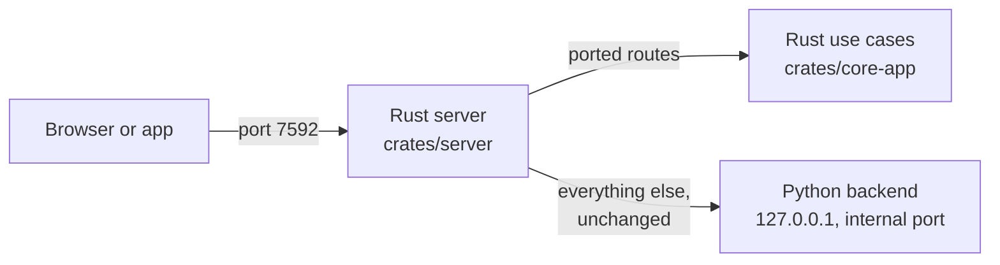

# Rust backend

The backend moves from Python to Rust one route at a time (roadmap, section 5). This document describes the state of
that port and the rules for continuing it.

## Request flow



The `ferrofolio` binary is the entry point of the server image. It first takes the public port, then binds a loopback
socket for the Python backend, starts Python as a child process that serves that socket (`--socket-fd`), and waits
until Python has answered an HTTP request on it. Only then does it listen on the public port; connections made
earlier are refused, as by the Python server. Because the gateway created the backend socket and only the child holds it, no other process can answer
in Python's place.

- **Forwarding.** Method, path, query, body and headers, including `Host`, `Authorization` and `X-Forwarded-*`, reach
  Python unchanged. Hop-by-hop headers are removed and the client address is appended to `X-Forwarded-For`, which
  uvicorn trusts from the loopback interface; a body without a known length is sent on with chunked framing, whatever
  the method. Responses are streamed, so long fetches, downloads and the MCP endpoint
  keep working. If Python cannot be reached the server answers `502` with the code `BACKEND_UNAVAILABLE`.
- **Lifecycle.** `SIGTERM` or `SIGINT` stops the public server, gives open requests three seconds, then sends
  `SIGTERM` to Python and kills it after six more seconds, which stays within Docker's default stop timeout of ten
  seconds. If Python exits on its own, the server exits with an error; with a
  restart policy such as the `unless-stopped` of the example compose file, Docker starts both again, otherwise the
  container stays stopped until someone restarts it.
- **Options.** The server accepts the options of `finanze/args.py` and passes them on, except that `--port` cannot be
  `0`: Python builds redirect URLs with that port. `--log-level NONE` silences the server's console output entirely.
  Python is started with
  the inherited socket, `--host 127.0.0.1`, its port and `--public-port <public port>`, which keeps the redirect URLs it builds for
  GoCardless and the ChatGPT sign-in on the public port. Additional settings:

| Variable / option | Default | Meaning |
|---|---|---|
| `FERROFOLIO_BACKEND_PORT` / `--backend-port` | `0` (a free port) | Loopback port for the Python backend |
| `FERROFOLIO_PYTHON` / `--python` | `python3` | Interpreter that starts the backend |
| `FERROFOLIO_BACKEND_APP` / `--backend-app` | `finanze` | Path of the Python package |

## Crates

| Crate | Python counterpart | Content |
|---|---|---|
| `core-domain` | `finanze/domain` | `Dezimal`, calendar arithmetic with `dateutil.relativedelta` semantics, domain types and errors as they are needed |
| `core-app` | `finanze/application` | Ports such as `Clock` and `LoanCalculatorPort`, use cases, the loan calculator |
| `server` | `finanze/infrastructure/controller`, `server.py` | Forwarding, process management, ported routes and their session check |

`Dezimal` reproduces Python's `decimal` arithmetic in its default context: every result of `+ - * /` is the exact
result rounded to 28 significant digits with `ROUND_HALF_EVEN`, and integer powers follow libmpdec. Values below
10^-999999 become subnormal and keep fewer digits, down to the smallest one, 10^-1000026; a result of at most half
of that rounds to zero, as in Python. A decimal with a bounded scale such as
`rust_decimal` (at most 28 decimal places and a 96-bit coefficient) cannot reproduce 28 significant digits in
general: `150 × (0.01 / 12)` is 0.125 in Python, rounded to cents with `ROUND_HALF_UP` that is 0.13, while `rust_decimal` cut
`0.01 / 12` at 28 decimal places, got a product just below 0.125 and rounded it to 0.12.
`tests/parity/generate_decimal_fixtures.py` records
thousands of operations from Python, and `crates/core-domain/tests/decimal_parity.rs` requires the same results.
Its operators return a `Checked` value that carries a decimal signal (overflow, division by zero, invalid
operation) through a whole formula instead of panicking; the formula is unwrapped once with `value()`. Amounts
become `f64` only in the response types of the server, because the API carries them as JSON numbers; requests never
pass an amount through a float for arithmetic.

Amounts in requests are parsed exactly from their text. Strings follow Python's `Decimal(str)`: surrounding
whitespace, every underscore and digits of any script are accepted. JSON numbers are read from their digits, with or
without a fraction or an exponent; Python reads a JSON number with a fraction or an exponent as a float first, so
the two differ whenever that conversion changes the value, for example `9007199254740993.0`, `9007199254740993e0` or
a number with more than 17 significant digits: a recorded deviation. Amounts keep up to 38 significant digits;
a longer one is rejected rather than rounded, because rounding it could change a cent. One test reads a float on
purpose: whether a savings scenario has a `target_amount` follows Python's truth test of the JSON value, which reads
a number with a fraction or an exponent as a float, so a value that underflows to zero, such as `1e-400`, means no
target in both. The amount of a target that is kept is parsed exactly.

## Ported routes

| Route | Python origin | Since |
|---|---|---|
| `POST /api/v1/calculation/loan` | `routes/calculate_loan.py`, `calculations/loan_calculator.py` | Calculators (phase 4, slice 8, pulled forward) |
| `POST /api/v1/calculations/savings` | `routes/calculate_savings.py`, `use_cases/calculate_savings.py` | Calculators |

The list in code is `PORTED_ROUTES` in `crates/server/src/app.rs`; `crates/server/ported_routes.json` repeats it for
`tests/unit/infrastructure/controller/test_ported_routes.py`, which checks that Python still declares every ported
route, and a Rust test keeps the two lists equal. Other methods on these paths, in particular CORS preflight
requests, still go to Python, which keeps the routes until the cutover. Python decodes percent-escapes in the path
before routing, so Rust serves a ported route also when its path is spelled with escapes; requests it forwards keep
the path as the client sent it. Responses of ported routes carry the CORS headers quart-cors would add.

Calculations run on the blocking thread pool, at most one per core; further requests wait up to 30 seconds and are
then refused with `503 SERVER_BUSY` and `Retry-After: 5`. Within the input limits the slowest request found, 50
savings scenarios solving a 200-year retirement at a negative performance, holds its core for about four seconds. A
request body of a
ported route may have at most 1 MiB (a deviation: Python accepts 50 MB). Bodies count against a budget of 64 MiB
while they are read and decoded, so that waiting requests cannot hold an unbounded amount of memory; a body without
`Content-Length` counts with the largest size. One deadline of 60 seconds covers the wait for the budget and the
read. On shutdown, calculations still running get half a second after the server has stopped.

Startup keeps Python's behaviour of refusing connections until the backend is ready: the public address is bound
first but listens only then. Two servers started at the same time on the same address can therefore both start
their backend before the second fails to listen, as two Python servers could before; separate containers do not
share addresses.

## Sessions

Python issues and checks the API session tokens and stays the only place that knows them; Rust keeps no session
state. A ported route asks Python whether the request may proceed: it sends `GET /api/v1/status` with the client's
own `Authorization` header and proceeds only when the status is `UNLOCKED`, which Python reports exactly when the
data is unlocked and the request is authorised by a valid session token or because `FINANZE_API_SESSION` is off.
Otherwise the route answers `401 NOT_LOGGED` like Python's session guard. When Python cannot be reached or its
answer is not a readable status, the route answers `502`; when it does not answer within 30 seconds, `504`. The
calculation does not run in either case. Login, signup and logout are forwarded
unchanged; responses that carry a token get `Cache-Control: no-store`.

Asking costs one request on the loopback interface per call of a ported route. Once login and sessions move to Rust
(phase 4, slice 1), Rust becomes the session authority and the question goes away.

## Parity tests

A route moves to Rust together with fixtures recorded from the Python route.
`tests/parity/generate_calculation_fixtures.py` sends hand-written and seeded random requests through the real Quart
routes and the production session guard, with a fixed date, and writes the responses to
`crates/server/tests/fixtures/calculations_parity.json`.
`crates/server/tests/parity_calculations.rs` replays every case against the Rust router. CI runs the generator with
`--check` in the Python job, so the fixtures cannot drift from the Python code.

Regenerate the fixtures after changing a Python calculator:

```sh
python tests/parity/generate_calculation_fixtures.py --output crates/server/tests/fixtures/calculations_parity.json
```

Each case states what it compares:

| Mode | Rust must return |
|---|---|
| `full` | The status and the body of Python's response; numbers compare by value |
| `status_code` | The status and the `code` field; used where Python's message comes from pydantic |
| `status` | The status only; available for answers that are not JSON, no case uses it at present |
| `deviation` | The status and code recorded with the reason for the deviation, or, for a case with an `equivalent_request`, Python's status and body for that request as Rust reads it (stored in `deviation.body`); the fixture keeps a digest of Python's body so that `--check` notices when Python's answer changes |

### Known deviations

| Input | Python | Rust |
|---|---|---|
| A period rate of exactly −100 % | Computes with `Decimal` infinities, `0 ** -n` is `Infinity` | `500 UNEXPECTED_ERROR`, division by zero |
| `NaN` or `Infinity` as an amount | Accepted by `Decimal` and fails later | `400 INVALID_REQUEST` |
| An amount with more than 38 significant digits, in any form | Kept exactly as a string or integer, rounded to a float as a number with a fraction or an exponent | `400 INVALID_REQUEST` |
| A JSON number with a fraction or an exponent whose value a float cannot hold exactly, up to 38 significant digits | Rounded to a float first | Kept exactly |
| A request body above 1 MiB | Accepted up to 50 MB | `413 PAYLOAD_TOO_LARGE`; a decoded JSON value takes many times the memory of its text |
| An object whose first key is `$serde_json::private::Number`, serde_json's private token for exact numbers | An unknown field, ignored | `400 INVALID_REQUEST` |
| A loan date that is neither a string nor `null` | `500` | `400 INVALID_REQUEST` |
| A request body that is JSON but neither an object nor empty (for example `[1]`), or a `retirement` that is neither an object nor `null` | `500` | `400 INVALID_REQUEST` |
| Malformed JSON | `400` with an HTML page | `400 INVALID_REQUEST` as JSON |
| The literals `NaN`, `Infinity` and `-Infinity`, which are not JSON | Accepted by the `json` module, the calculation fails with `500` | `400 INVALID_REQUEST`, the body is not JSON |
| An integer field beyond the float range, such as `"years": 1e400` | Read as infinity, fails with `500` | `400 INVALID_REQUEST` with Python's message |
| An integer field beyond 64 bits, such as `fixed_years` | Accepted, fails later with `500` | `400 INVALID_REQUEST` |
| `withdrawal_years` beyond 64 bits | Computed; without a `withdrawal_amount` the withdrawal loop runs for that many periods and does not finish in practice | `400 INVALID_REQUEST` |
| An amount whose exponent is beyond 32 bits, such as `"1e-2147483649"` | Accepted by `Decimal`, which takes any exponent | `400 INVALID_REQUEST` |
| A number in the response beyond the float range, such as a rate of `1e400` echoed back when no amount has to be rounded | `200` with `Infinity`, which is not JSON | `500 UNEXPECTED_ERROR` |
| Messages of pydantic validation errors | Full pydantic text | The first lines of it |
| More than 200 years of accumulation or retirement, or more than 50 scenarios (savings) | Computed, however long it takes and however much memory it needs | `400 INVALID_REQUEST` |
| A calculation that finds every core busy for 30 seconds (no fixture case, which would need concurrent requests; `tests/gateway.rs` covers it) | Waits; a calculation blocks Python's event loop and every other request with it | `503 SERVER_BUSY` with `Retry-After: 5` |
| A ported route while the database is locked, with or without a session | Allowed: the session guard lets everything through while locked | `401 NOT_LOGGED` (fixture cases "no session while the data is locked" and "session while the data is locked") |

### Known issues of the Python reference

Reviews of the port found these weaknesses in the Python calculators. The Rust code reproduces them on purpose, marked
with a comment at each place: a ported route keeps its behaviour, and changes to money arithmetic and rounding need
a maintainer's decision (AGENTS.md). Each should be fixed in Python and Rust together, with regenerated fixtures.

| | Where | Issue |
|---|---|---|
| L1 | Loan, outstanding simulated from the start date | Each simulated payment spreads the balance over the periods to `end` without the installment due on `end`, while the payment reported for today includes it, so the simulated payments are slightly higher |
| L2 | Loan, monthly to yearly schedules | Periods are counted in calendar months, but the schedule steps from date to date; a start on the 31st steps to the 28th after February, and the count can be one installment short |
| L3 | Loan, fixed rate with a known amount | An installment counts as paid only once the next installment date is reached, so right after a payment the reported balance still includes it |
| L4 | Loan, remaining balance | Once the count of payments reaches the count of periods, the balance is zero whatever is still unpaid |
| L5 | Loan, fixed rate with a known amount | The schedule has an installment on `start` and one on `end`, but the annuity is spread over the intervals between them, one fewer than the installments |
| L6 | Loan, dates | An `end` before `start` is accepted; the next installment is then `start`, after the end of the loan |
| L7 | Loan, end of the calendar | Counting the periods steps once past `end`, so a schedule ending in the last period before 31 December 9999 fails with `500` and "date value out of range" |
| S1 | Savings, contribution solved for a retirement | When the balance cannot cover a withdrawal, the withdrawal is cut to the balance without counting the shortfall, so the search can accept a contribution that does not fund the last withdrawal in full |
| S2 | Savings, contribution solved for a target | The ordinary annuity factor ignores that the projection applies the return after each contribution, so the projected balance misses the target by about one period's return: above it for positive returns, below it for negative ones |
| S3 | Savings, horizon solved for a target | The search applies unrounded returns while the projection rounds them to cents, so with very small balances or rates the reported horizon can fall short of the target |
| S4 | Savings, retirement | A negative `withdrawal_amount` is accepted and adds to the balance instead of being rejected |
| S5 | Savings, contribution solved for a target | A rate so small that `1 + rate` rounds to 1 makes the annuity factor zero, and the division fails with `500` instead of treating the rate as zero |

## Running locally

```sh
cargo run --bin ferrofolio -- --port 7592 --data-dir .storage --log-dir .storage/logs --log-level DEBUG
```

The server starts `python3 finanze` from the repository root; set `FERROFOLIO_PYTHON` to the interpreter of the
virtual environment if needed.

## Next steps

1. `infra-db`: open existing SQLCipher databases with `rusqlite` and read the migration state.
2. Phase 4, slice 1: status, login and settings in Rust; Rust then holds the sessions itself.
3. Read paths (positions, transactions, timelines), each with parity fixtures from a fixture database.
