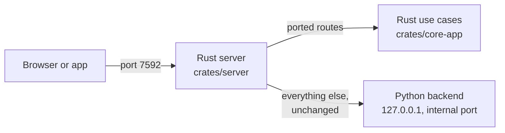
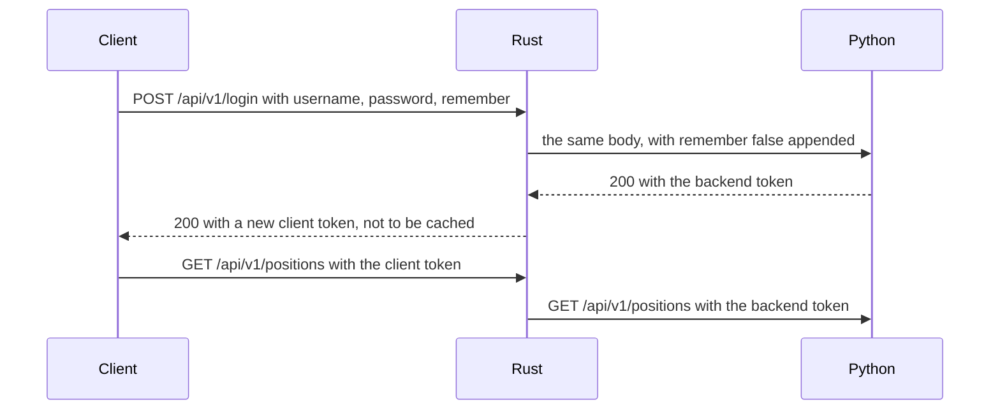

# Rust backend

The backend moves from Python to Rust one route at a time (roadmap, section 5). This document describes the state of
that port and the rules for continuing it.

## Request flow



The `ferrofolio` binary is the entry point of the server image. It first takes the public port, then binds a loopback
socket for the Python backend, starts Python as a child process that serves that socket (`--socket-fd`), and waits
until Python has answered an HTTP request on it. Only then does it listen on the public port; connections made
earlier are refused, as by the Python server. Because the gateway created the backend socket and only the child holds it, no other process can answer
in Python's place.

- **Forwarding.** Method, path, query, body and headers, including `Host`, `Authorization` and `X-Forwarded-*`, reach
  Python unchanged, except that the token of a valid session becomes the backend token and a login asks for a lasting
  one (see [Sessions](#sessions)). Hop-by-hop headers are removed and the client address is appended to `X-Forwarded-For`, which
  uvicorn trusts from the loopback interface; a body without a known length is sent on with chunked framing, whatever
  the method. Responses are streamed, so long fetches, downloads and the MCP endpoint
  keep working. If Python cannot be reached the server answers `502` with the code `BACKEND_UNAVAILABLE`.
- **Lifecycle.** `SIGTERM` or `SIGINT` stops the public server, gives open requests three seconds, then sends
  `SIGTERM` to Python and kills it after six more seconds, which stays within Docker's default stop timeout of ten
  seconds. If Python exits on its own, the server exits with an error; with a
  restart policy such as the `unless-stopped` of the example compose file, Docker starts both again, otherwise the
  container stays stopped until someone restarts it.
- **Options.** The server accepts the options of `finanze/args.py` and passes them on, except that `--port` cannot be
  `0`: Python builds redirect URLs with that port. `--log-level NONE` silences the server's console output entirely.
  Python is started with
  the inherited socket, `--host 127.0.0.1`, its port and `--public-port <public port>`, which keeps the redirect URLs it builds for
  GoCardless and the ChatGPT sign-in on the public port. Without `--data-dir`, the server takes Python's default,
  `appdirs.user_data_dir("Ferrofolio")` (`$XDG_DATA_HOME/Ferrofolio`, else `~/.local/share/Ferrofolio`, on macOS
  `~/Library/Application Support/Ferrofolio`), and passes it on, so that both use the same directory. Before, it
  moves a `Finanze` directory from before the rename there once, as `finanze/data_dir.py` does when Python runs on
  its own: only if the new directory is missing or empty, and if the move fails the old directory stays in use. Additional
  settings:

| Variable / option | Default | Meaning |
|---|---|---|
| `FERROFOLIO_BACKEND_PORT` / `--backend-port` | `0` (a free port) | Loopback port for the Python backend |
| `FERROFOLIO_PYTHON` / `--python` | `python3` | Interpreter that starts the backend |
| `FERROFOLIO_BACKEND_APP` / `--backend-app` | `finanze` | Path of the Python package |

## Crates

| Crate | Python counterpart | Content |
|---|---|---|
| `core-domain` | `finanze/domain` | `Dezimal`, calendar arithmetic with `dateutil.relativedelta` semantics, Python's `datetime` as the backend stores it, the settings, domain types and errors as they are needed |
| `core-app` | `finanze/application` | Ports such as `Clock`, `LoanCalculatorPort` and `ConfigPort`, use cases, the loan calculator |
| `infra-db` | `finanze/infrastructure/repository` | Opens the encrypted database read-only, reads its migration state; repositories that read it (settings) |
| `server` | `finanze/infrastructure/controller`, `server.py`, `infrastructure/api_session`, `infrastructure/user_files` | Forwarding, process management, API sessions, unlocking the database at a login, ported routes |

`Dezimal` reproduces Python's `decimal` arithmetic in its default context: every result of `+ - * /` is the exact
result rounded to 28 significant digits with `ROUND_HALF_EVEN`, and integer powers follow libmpdec. Values below
10^-999999 become subnormal and keep fewer digits, down to the smallest one, 10^-1000026; a result of at most half
of that rounds to zero, as in Python. A decimal with a bounded scale such as
`rust_decimal` (at most 28 decimal places and a 96-bit coefficient) cannot reproduce 28 significant digits in
general: `150 × (0.01 / 12)` is 0.125 in Python, rounded to cents with `ROUND_HALF_UP` that is 0.13, while `rust_decimal` cut
`0.01 / 12` at 28 decimal places, got a product just below 0.125 and rounded it to 0.12.
`tests/parity/generate_decimal_fixtures.py` records
thousands of operations from Python, and `crates/core-domain/tests/decimal_parity.rs` requires the same results.
Its operators return a `Checked` value that carries a decimal signal (overflow, division by zero, invalid
operation) through a whole formula instead of panicking; the formula is unwrapped once with `value()`. Amounts
become `f64` only in the response types of the server, because the API carries them as JSON numbers; requests never
pass an amount through a float for arithmetic.

Amounts in requests are parsed exactly from their text. Strings follow Python's `Decimal(str)`: surrounding
whitespace, every underscore and digits of any script are accepted. JSON numbers are read from their digits, with or
without a fraction or an exponent; Python reads a JSON number with a fraction or an exponent as a float first, so
the two differ whenever that conversion changes the value, for example `9007199254740993.0`, `9007199254740993e0` or
a number with more than 17 significant digits: a recorded deviation. Amounts keep up to 38 significant digits;
a longer one is rejected rather than rounded, because rounding it could change a cent. One test reads a float on
purpose: whether a savings scenario has a `target_amount` follows Python's truth test of the JSON value, which reads
a number with a fraction or an exponent as a float, so a value that underflows to zero, such as `1e-400`, means no
target in both. The amount of a target that is kept is parsed exactly.

### Domain modules

`core-domain` ports the modules of `finanze/domain` one at a time, each to a Rust module of the same name, ahead of
the routes that need them (the read paths of phase 4, slice 2, need the positions and what they are built from).

| Python module | Ported |
|---|---|
| `commodity.py`, `constants.py`, `crypto.py`, `entity.py`, `entity_account.py`, `fetch_record.py`, `global_position.py`, `profitability.py`, `public_key.py` | Completely |
| `calculations.py`, `loan_calculator.py` | The types of the calculators |
| `dezimal.py` | See above; `round(value, n)` is `Dezimal::round` for nonnegative `n` (Python also rounds to tens with a negative `n`), `f"{value:.2f}"` is `Dezimal::to_fixed` |
| `earnings_expenses.py` | `FlowFrequency` |
| `external_integration.py` | `ExternalIntegrationId`, `ExternalIntegrationPayload`, `EnabledExternalIntegrations` |

The port follows Python's types:

- A `(str, Enum)` class becomes an enum declared with `str_enum!`, which gives it the values of the Python members in
  their order (`ALL`, `as_str`, `from_value`, the trait `StrEnum`) and orders members by value, as Python does.
- A dataclass becomes a struct with the same fields, `type` written as `r#type`. `Optional` becomes `Option`, `int`
  becomes `i64`, `UUID` becomes `uuid::Uuid` (re-exported as `core_domain::Uuid`), `date` becomes jiff's civil
  `Date`, and `datetime` becomes `core_domain::datetime::DateTime`, which is naive or aware like a Python `datetime`
  read from the database with `fromisoformat`, and compares as Python does. A `dict` becomes an `IndexMap`, which
  keeps the order of insertion as a Python `dict` does and, like it, compares regardless of order.
- `ExternalIntegrationPayload`, a `dict[str, str]` of credentials in Python, is a map whose `Debug` output shows the
  keys only, so that no credential reaches a log through a type that holds it.
- Values are written as struct literals. A Python default that is not the default of the Rust type (`None`,
  `False`, zero, an empty string or list, or the variant an enum marks `#[default]`, such as `DataSource::Real`)
  comes from a `new` constructor that takes the required fields.
- `__post_init__` becomes a `post_init` method that takes the struct as written and returns it with the derived
  fields, or the error Python raises (`MissingFieldsError` or a decimal signal). `BaseData`, the base class of the
  positions, is not ported: its only method, `from_dict`, is called nowhere. `Crowdlending.distribution` and
  `entries`, a `dict` and a `list` without types that no domain logic reads, hold their JSON text, but compare by
  parsed value, so object keys in a different order compare equal as in Python.
- `Account`'s `Debug` output leaves out the IBAN, which must not reach a log.
- Nothing in the domain reads the clock: where Python calls `datetime.now()`, the Rust function takes the time as a
  parameter, such as the `today` of `annualized_profitability` and of the `post_init` of factoring, real estate
  crowdfunding and deposits. `settings.rs` uses serde to write the shape Python stores; the other modules leave
  mapping to rows and to JSON to `infra-db` and `server`.

Four differences are known. `compute_loan_hash` and `compute_investment_hash` read the amount like `Dezimal(str)`,
which in Rust rejects `NaN`, infinities and more than 38 significant digits; Python hashes them. An amount whose
exponent is beyond one million is refused before the hash writes it in plain text, where Python would try to
allocate the whole expansion; none of the recorded cases uses one. A crypto fetch merge that overflows leaves
Python's left operand partly updated from before the error, while Rust consumes its operands and exposes no partial
result, so callers must not rely on that state. And `crypto_rate_key` changes the case of a symbol or contract address
with the standard library of each language, and Rust 1.99 knows Unicode 17 while Python 3.14 knows Unicode 16, so the
56 letters added in Unicode 17 change case in Rust and stay as they are in Python. No ticker symbol or hex address
contains them.

`tests/parity/generate_domain_enum_fixtures.py` writes `domain_enums.json`, every enum of the ported modules with its
values in order (for a completely ported module every enum it defines, so a new one makes `--check` fail), and
`domain_cases.json`, inputs and Python's outputs for the functions the generator has cases for, with a fixed date
where Python reads the clock; `crates/core-domain/tests/domain_parity.rs` requires Rust to have the same enums and
compute the same outputs of those cases. Not every function with logic has a case, for example the date a
`GlobalPosition` takes when none is supplied; CI checks only what the generator records. It runs with `--check`.

## Ported routes

These routes are served by Rust; every other route under `/api/v1` is forwarded to Python. The progress of the port
is tracked in [#91](https://github.com/ferrofolio/ferrofolio/issues/91), which a pull request that ports a route
updates together with this table.

| Route | Python origin | Since |
|---|---|---|
| `POST /api/v1/calculation/loan` | `routes/calculate_loan.py`, `calculations/loan_calculator.py` | Calculators (phase 4, slice 8, pulled forward) |
| `POST /api/v1/calculations/savings` | `routes/calculate_savings.py`, `use_cases/calculate_savings.py` | Calculators |
| `GET /api/v1/settings` | `routes/get_settings.py`, `use_cases/get_settings.py`, `repository/settings` | Status, login, settings (phase 4, slice 1); reads the database |
| `GET /api/v1/labels` | `routes/get_labels.py`, `use_cases/get_labels.py`, `repository/labeling/label_repository.py` | Read paths (phase 4, slice 2); reads the database |
| `GET /api/v1/labeling/rules` | `routes/get_labeling_rules.py`, `use_cases/get_labeling_rules.py`, `repository/labeling/labeling_rule_repository.py` | Read paths (phase 4, slice 2); reads the database, passes unusual stored conditions on |
| `GET /api/v1/flows/periodic` | `routes/get_periodic_flows.py`, `use_cases/get_periodic_flows.py`, `repository/earnings_expenses/periodic_flow_repository.py` | Read paths (phase 4, slice 2); reads the database, passes unusual stored values on |
| `GET /api/v1/flows/pending` | `routes/get_pending_flows.py`, `use_cases/query_pending_flows.py`, `repository/earnings_expenses/pending_flow_repository.py` | Read paths (phase 4, slice 2); reads the database, passes unusual stored values and pages beyond `i64` on |

The list in code is `PORTED_ROUTES` in `crates/server/src/app.rs`; `crates/server/ported_routes.json` repeats it for
`tests/unit/infrastructure/controller/test_ported_routes.py`, which checks that Python still declares every ported
route, and a Rust test keeps the two lists equal. Other methods on these paths, in particular CORS preflight
requests, still go to Python, which keeps the routes until the cutover. Python decodes percent-escapes in the path,
collapses leading slashes and ignores the case of the method before routing, so Rust serves a ported route also when
it is spelled `/api/v1/calculation/%6Coan`, `//api/v1/calculation/loan`, `/%2Fapi/v1/calculation/loan` or with a
lowercase `post`, with the same limits; requests it forwards keep the method and path as the client sent them. Responses of ported routes carry the CORS headers quart-cors would add.

Calculations and reads of the database run on the blocking thread pool, at most one per core; further requests wait
up to 30 seconds and are then refused with `503 SERVER_BUSY` and `Retry-After: 5`. Within the input limits the slowest request found, 50
savings scenarios solving a 200-year retirement at a negative performance, holds its core for about four seconds. A
request body of a
ported route may have at most 1 MiB (a deviation: Python accepts 50 MB). Bodies count against a budget of 64 MiB
while they are read and decoded, so that waiting requests cannot hold an unbounded amount of memory; a body without
`Content-Length` counts with the largest size. One deadline of 60 seconds covers the wait for the budget and the
read. On shutdown, calculations still running get half a second after the server has stopped.

Startup keeps Python's behaviour of refusing connections until the backend is ready: the public address is bound
first but listens only then. Two servers started at the same time on the same address can therefore both start
their backend before the second fails to listen, as two Python servers could before; separate containers do not
share addresses.

## Routes that read the database

A route that reads the user's database follows the layers of the Python backend: the repository in `infra-db`
borrows the `Database` for one request and implements a port of `core-app` (the settings: `SettingsRepository`
implements `ConfigPort`), the use case borrows the port (`GetSettings`), and the route in `server` hands both to
`routes::database::serve`. The route first reads its parameters, as the Python route does before it touches the
database, and may answer from them alone, for example `400` for an unknown settings section. The work on the database
then runs on the blocking pool once a permit is free, through `Sessions::with_database`, which fails at once while a
request that replaces or rekeys the database is with Python (`Replacing`) and while Rust has no database open
(`Locked`), and opens the database again when its file was replaced.

Until the cutover Python stays the authority on whether the data is unlocked. It locks and unlocks the data without a
request Rust sees, when a change of the password fails, and Rust can have no database open while Python
has, after a logout that raced a login, while a request replaces the database, or when Rust could not open it. Such a
route therefore asks Python before it reads, with API sessions too: `GET /api/v1/status` with the `Authorization` the
request would reach Python with, the backend token of a valid session or, without API sessions, the client's own
header. Python reports `UNLOCKED` exactly when its data is unlocked and the request authorised.

| Rust's sessions | Python's status for the request | Rust's database | Answer |
|---|---|---|---|
| A valid session, or API sessions off | `UNLOCKED` | Readable | Rust answers from its database |
| A valid session, or API sessions off | `UNLOCKED` | `Locked`, `Replacing` or failing to open | Passed on to Python |
| A valid session, or API sessions off | Anything else: locked, also on its own after a failed change of the password, or the request not authorised | Not read | Passed on to Python |
| API sessions on, no valid session | Not asked | Not read | Passed on to Python |
| | No answer, or no readable status | Not read | `502 BACKEND_UNAVAILABLE`, `504 BACKEND_TIMEOUT` after 30 seconds |

A request passed on reaches Python as every forwarded request does, with the backend token of a valid session, so
Python answers as it always has: with its data, with `401 NOT_LOGGED` while its data is locked (also `400` first for
an invalid parameter, as its route reads the parameters before the database), or with `401` from its session guard.
Rust thus never answers with data Python would not give, nor as locked where Python would answer with data. The
check costs one request to Python on the loopback interface per request. A logout that races a read is ordered after
it, as in Python, where a read that has started finishes too.

A route may also pass a request on after it has read the database, when it finds a value stored in a form that
Python's own writer does not produce and that Python reads only through its coercions (`ReadError::Unreadable` in
`core-app`, `Reply::PassOn` in the server). The labeling rules store their conditions as JSON, which Python reads with
`json.loads`, `Dezimal`, `date.fromisoformat` and pydantic in lax mode: `"3"` or `3.0` as a day of the month becomes
`3`, `"20260101"` a date, an integer an amount. Rust reads exactly the forms `serialize_conditions` writes, falsy
values as Python's truth tests read them, unknown keys ignored, and leaves every other form to Python, which answers
from the same data as it always has: with the rule, or with `500` where it fails. Rust therefore needs no copy of
those coercions and never answers where Python would not. The pass-on is logged with the field, never with the stored
value.

The periodic flows are columns, which Python maps into a pydantic dataclass that reads `"true"` as a flag and a
number as an amount. Rust reads the forms `PeriodicFlowRepository.save` stores (a flag as `0`
or `1`, a date as `YYYY-MM-DD`, an amount as the text of a `Dezimal`), reads the alternate forms the parity fixtures
record as "other" (such as braced UUIDs and `" 1_000.5 "`), and passes the remaining forms on. It computes each
flow's next date with the server's clock, as `date.today()` does in Python, and passes the request on where Python's
date arithmetic leaves the range of `date`, which Python answers with `500`. The query has no `ORDER BY`, as in
Python, so Rust sends the same statement and gets the flows in the same order.

The pending flows are read the same way. The time of the last status change is read only in the form
`datetime.isoformat()` writes it and gives back unchanged, with an offset of whole minutes; pydantic reads other
forms, such as `Z`, a space as the separator, `.000000` or a number of seconds, to a time that `isoformat()` writes
differently, so Rust passes them on. The query is read as `request.args` reads it: an unknown status, type, sort field
or order fails with Python's message in Python's order, and `page` and `limit` follow `int()`, which strips Unicode
whitespace but keeps the separators U+001C to U+001F, accepts digits of any script and falls back to none for
anything else. Paging follows Python's slices, also for a zero or negative page or limit; a `page` or `limit` outside
`i64`, which Python holds exactly, is passed on, and so are statistics whose sum a float cannot hold, which Python
writes as `Infinity`.

Python reads the settings from the database on every request and keeps no copy, and Rust's read-only connection reads
what Python has committed with every new statement (WAL mode), so a change Python writes with `POST
/api/v1/settings`, which stays in Python, is read by the next `GET` in either. Times stored without an offset are
taken as local time in the server's time zone, which Rust reads from `TZ` and `/etc/localtime` as Python's C library
does; `lastUpdate`, when no section asked for has a stored time, is the time the server started, as in Python.

## Sessions

Rust holds the API sessions (phase 4, slice 1). It issues and checks the tokens clients use, as Python's
`InMemoryApiSessionStore` did: 32 random bytes in URL-safe Base64, kept only as their SHA-256 digest, valid until the
next logout, or for a remembered session until `FINANZE_API_SESSION_REMEMBER_DAYS` days have passed.
`FINANZE_API_SESSION` and `FINANZE_API_SESSION_REMEMBER_DAYS` are read by both processes from the same environment,
with the rules of `finanze/args.py`; with sessions off, Rust keeps none and passes login, signup and logout on
unchanged. Python keeps its session guard, its login and its logout, and stays the second line of defence:



- **Login and signup.** When Python answers `200` with its token, Rust keeps that token as the backend token, starts
  a session and answers with a token of its own; Python's token never reaches a client. A `200` without a token is
  answered with `502` rather than passed on. Every other answer, such as `204` for a guest's signup or an error, passes
  through and starts no session. Rust reads the body to do this, with the limits and the body budget of the ported
  routes. A logout that ends the sessions while a login is with Python may have ended the backend token as well, so
  that login starts no session and is answered with `500 UNEXPECTED_ERROR`; the client logs in again.
- **The backend token lasts until the logout.** Rust appends `"remember": false` to the JSON object of a login, and
  Python's `json` module keeps the last of repeated keys; the rest of the body reaches Python unchanged. Rust applies
  the client's `remember` to its own session, so the backend token outlives the session. Each session keeps the backend
  token of its own login and never uses a later one, so a session that Python has ended stays ended there, whatever
  logins follow. A body Rust cannot read as a JSON object goes on unchanged, so that Python answers it as
  before; should Python accept it, Rust starts no session and answers `400 INVALID_REQUEST`.
- **Requests.** A request with the token of a valid session reaches Python with `Authorization: Bearer` and the
  backend token instead. Every other request reaches Python as the client sent it, so Python's session guard and its
  status route decide about it as before: with a token Python does not know, the data counts as locked for the
  status, and a guarded route answers `401 NOT_LOGGED` while the data is unlocked. The token of the MCP endpoint,
  which Python checks itself, passes through untouched.
- **Logout.** Rust passes it on, with the backend token for a valid session. Python's logout handler ends its sessions
  before anything else, so they may be gone whenever the request reached it, and a session Rust kept would come back
  with the backend token of the next login. A logout with a valid session carries the backend token, which Python's
  guard accepts, so Rust ends every session and forgets the backend token before it passes the logout on; a login
  still with Python then starts no session either. Any other logout ends them once Python has answered, unless it
  refused with a `3xx` or `4xx`, such as the `401` of its guard while the data is unlocked: on success, on a server
  error and when the connection fails. Such a logout runs to its end even when the client goes away. Python only lets
  it through while the data is locked; until it answers, Rust's sessions still pass the ported routes, while their
  backend tokens, which Python has ended, are refused on every forwarded route.
- **Unlocking.** Once Python has accepted a login or signup, with or without a token, and unless it is a guest's
  signup, Rust opens the user's database itself, read-only, with the password from the request: it finds the user's
  id in `profiles.json` in the data directory, as Python's `get_user` does, and opens `profiles/<id>/data.db` with
  `infra-db` (see [Database](#database)). Python has migrated the database before it answered. Rust also opens it
  with the credentials of Python's automatic login at startup (`USERNAME` and `PASSWORD`), and, without API sessions,
  at a login Python refuses with `409` because the data is already unlocked, when the password opens the database.
  Python checks that a login names the unlocked user only when it answers with a token: it refuses every login with
  `409` while unlocked, and answers `204` to a login that a concurrent one overtook (`AlreadyUnlockedError`), whichever
  user they name. With API sessions Rust therefore ignores a `204`, after which the overtaking login's `200` unlocks
  the database; without them, after a `204` or `409`, it opens the database only if `GET /api/v1/status` names the
  login's user as the one Python unlocked, so that it never holds another user's database than the one Python serves.
  A further login of the user whose database Rust holds, from another client for example, keeps the open connection
  instead of deriving the key again. The logout that ends the sessions closes it, and a login that a logout overtakes
  keeps it closed. If Rust cannot open it, for example because the profile is missing, the login still succeeds. Rust keeps the credentials while the
  database is open, as Python's `DBManager` keeps the password, so that it can open it again: a change of the
  password (`POST /api/v1/change-password`) rewrites it with a new key. SQLite names the WAL and shared-memory files after the
  path, so a connection Rust kept open meanwhile would leave the old ones for Python's new connection, which can
  corrupt the new database. Rust therefore opens, installs and reads its connection only under a readers-writer lock
  (`Sessions::open_and_unlock`, `Sessions::with_database`). It reads the body of such a request first, so that a
  client that stalls while sending it holds no lock, then takes the lock for writing, which waits for readers and for
  logins that are opening the database, closes the connection, and holds the lock until Python has answered, also
  when the client goes away. Meanwhile a reader fails at once as for locked data, and a login waits before it opens
  the database. Afterwards a reader opens the database again (`UserDatabase::current`), as it does when the file has
  been replaced in any other way. After a successful change of the password, when the connection to Python fails, and
  when Python refuses or fails such a request, Rust drops the connection together with the credentials: a change of
  the password rekeys the file and locks it, and a failed one may still be writing it or may have rekeyed the file
  and locked the data before it failed. Nothing opens it until the next login, and a
  login that reached Rust before, and waited for the lock, keeps it closed as well. Only a request without a valid
  session, which Python's session guard refuses while the data is unlocked, leaves the connection alone, so that a
  client without a session cannot close it. Ported routes read the database only through `Sessions::with_database`, on the blocking pool.
  The `guest` flag of a signup is read with pydantic's rules for a `bool`, as Python's `LoginRequest` does.
- **Ported routes** need the data unlocked. With API sessions they check the session in Rust, which exists only
  between a login and the logout. Without them they still ask Python, which also unlocks and locks the data without a
  login Rust sees (the automatic login, a failed change of the password): they send `GET /api/v1/status` and
  proceed only on `UNLOCKED`, answer `502` when Python cannot be reached or its answer is not a readable status, and
  `504` when it does not answer within 30 seconds. Routes that read the database ask Python with API sessions too
  (see [Routes that read the database](#routes-that-read-the-database)).

Rust learns of an unlock and a lock only through the login, signup and logout it passes on, and the automatic login.
Python can also lock the data on its own, when a change of the password fails after it has closed the database. The
sessions then stay valid in both processes, as they did in Python, and ported routes keep accepting them until a login
of another user opens that user's database, which ends them in Rust, so that no session reads the data of a user it
does not belong to.
Without API sessions such a login is refused with `409`, and Rust opens the database with its password if Python's
status names its user. A route that reads the database answers from Rust's database only while Python reports the
data unlocked for the request, and passes it on to Python otherwise, so it neither reads a database Python has closed
nor answers as locked while Rust has none open.

Each session also remembers the user its login named, and reads Rust's database only while that user's is the one
Rust holds. A login Python accepts but whose database Rust cannot open, or a session that starts only after another
user's login has opened that user's database, therefore never reads another user's data; its requests go to Python.
A request Rust cannot read for in this way goes to Python before it waits for a permit for blocking work, so it is
never refused as busy where Python would answer.

## Parity tests

A route moves to Rust together with fixtures recorded from the Python route.
`tests/parity/generate_calculation_fixtures.py` sends hand-written and seeded random requests through the real Quart
routes and the production session guard, with a fixed date, and writes the responses to
`crates/server/tests/fixtures/calculations_parity.json`.
`crates/server/tests/parity_calculations.rs` replays every case against the Rust router. CI runs every generator
with `--check` in the `Parity` job, so the fixtures cannot drift from the Python code; the Rust tests that replay
them run in the `Rust` job.

Every generator under `tests/parity` runs only on the CPython version CI uses, which it reads from
`.github/workflows/ci.yml`, and stops with a message on any other: error messages and the Unicode database differ
between versions, and a fixture recorded with another one would not match what CI records.

Regenerate the fixtures after changing a Python calculator:

```sh
python tests/parity/generate_calculation_fixtures.py --output crates/server/tests/fixtures/calculations_parity.json
```

Each case states what it compares:

| Mode | Rust must return |
|---|---|
| `full` | The status and the body of Python's response; numbers compare by value |
| `status_code` | The status and the `code` field; used where Python's message comes from pydantic |
| `status` | The status only; available for answers that are not JSON, no case uses it at present |
| `deviation` | The status and code recorded with the reason for the deviation, or, for a case with an `equivalent_request`, Python's status and body for that request as Rust reads it (stored in `deviation.body`); the fixture keeps a digest of Python's body so that `--check` notices when Python's answer changes |
| `forwarded` | That Rust passes the request on to Python, which then gives the recorded answer; used by routes that read the database (see below) |

### Routes that read the database

`tests/parity/generate_db_route_fixtures.py` records the routes that read the user's database. A slice of the port
(`tests/parity/db_routes/<slice>.py`) defines scenarios: databases the Python backend creates with `DBManager` and
every migration and fills with fixed data through its repositories or their queries. Each is committed as
`crates/server/tests/fixtures/db_routes/<scenario>.db`, with the user and the password in the generator; the
scenario `empty`, which holds nothing beyond what the migrations seed, is shared by every slice. A database file takes
about 800 KB and is rewritten with every migration, so slices share scenarios where they can. `databases.json`
records the migrations of each database and its contents: the tables its scenario writes row by row, and every other
table by its number of rows, because the migrations seed rows with random ids and the current time.

Each case of a slice sends a request through the real Quart route and the production session guard against the
committed database of its scenario, with the data unlocked or locked and with a valid session, an unknown token or
none, in the time zone `CET-1CEST,M3.5.0,M10.5.0/3`, which Rust reads without a time zone database and which has
daylight saving time; the answers go to `<slice>.json`. Functions behind a route that one database row per case
cannot cover, such as parsers, are recorded there too. SQLCipher salts every database, so `--check`, which CI runs,
creates every scenario anew and requires the same contents as from the committed file, requires the migrations of
the current version, and records every case again against the committed files.

`crates/server/tests/common/database.rs` copies a fixture database into a data directory laid out as the backend lays
it out and starts the router with a stand-in for Python that accepts the login, reports the lock state on
`GET /api/v1/status` and answers every other request with a mark of the request as it arrived: its method, its URI
and its `Authorization` header. Tests log in through the router, so Rust opens the database as at a real login;
`database_harness.rs` checks that this opens every fixture database, with and without API sessions. A case that Rust
must pass on to Python compares `forwarded`: the stand-in received the same method and URI, and the backend token in
place of the client's session token, and Python then gives the recorded answer. The mark does not cover the body or
other headers; that the gateway passes those on unchanged is tested in `gateway.rs`.

Regenerate the fixtures after adding a migration or changing a slice:

```sh
python tests/parity/generate_db_route_fixtures.py --output crates/server/tests/fixtures/db_routes
```

SQLCipher salts every file, so `--output` keeps a committed database that still holds what its scenario defines and
writes only new or changed ones, and those whose schema lacks a table the scenario fills; the binary files change only
when their data does. A scenario's `normalize` replaces values the migrations generate anew in every database, such as
the ids of the seeded labels, with fixed ones, so that the comparison still sees every change to the scenario's own
rows. A slice's parity test replays its
cases with `common::database::replay`, which logs in once per database and lock state, and checks the functions it
records under `functions` against the Rust functions they describe (the labels record `uuid.UUID()` and the label
enums for inputs no database row could show; the labeling rules record how Python reads stored conditions, and the
periodic flows how Python maps stored rows, in the forms its writer produces, which Rust must read identically, and in
many it does not, where Rust may only pass the request on; the periodic flows also record the next date for every
frequency over starts and days around month ends, leap days and the end of the range; the pending flows record how
`args.get(name, type=int)` reads `page` and `limit`). A slice whose route reads the
date records with a fixed day, which it names in its `context` and the Rust test sets as the server's clock. A case with a valid session on unlocked data that Rust passes on because of the data it finds is marked
`passed_on` and compares as `forwarded`, with the backend token of the session. A body Python writes with `NaN` or `Infinity` is
recorded as no body, since it is not JSON.

The ids of rows are read with `core_domain::pyuuid::parse`, which follows `uuid.UUID(text)` exactly: it removes every
`urn:` and `uuid:`, strips braces from both ends, removes every hyphen, and reads the 32 remaining characters with `int(text, 16)`, which accepts
surrounding whitespace, a `+`, a `0x` prefix, single underscores and decimal digits of any script, and answers with
Python's messages otherwise. A route that maps an id Python cannot read answers `500 UNEXPECTED_ERROR` with the same
message as Python.

### Known deviations

| Input | Python | Rust |
|---|---|---|
| A period rate of exactly −100 % | Computes with `Decimal` infinities, `0 ** -n` is `Infinity` | `500 UNEXPECTED_ERROR`, division by zero |
| `NaN` or `Infinity` as an amount | Accepted by `Decimal`; the loan calculator rejects it with `400 INVALID_REQUEST` (L12), the savings calculator fails later | `400 INVALID_REQUEST` when the request is read |
| An amount with more than 38 significant digits, in any form | Kept exactly as a string or integer, rounded to a float as a number with a fraction or an exponent | `400 INVALID_REQUEST` |
| A JSON number with a fraction or an exponent whose value a float cannot hold exactly, up to 38 significant digits | Rounded to a float first | Kept exactly |
| A request body above 1 MiB | Accepted up to 50 MB | `413 PAYLOAD_TOO_LARGE`; a decoded JSON value takes many times the memory of its text |
| An object whose first key is `$serde_json::private::Number`, serde_json's private token for exact numbers | An unknown field, ignored | `400 INVALID_REQUEST` |
| A request body that is JSON but neither an object nor empty (for example `[1]`), or a `retirement` that is neither an object nor `null` | `500` | `400 INVALID_REQUEST` |
| Malformed JSON | `400` with an HTML page | `400 INVALID_REQUEST` as JSON |
| The literals `NaN`, `Infinity` and `-Infinity`, which are not JSON | Accepted by the `json` module; the loan calculator rejects them with `400`, as not finite | `400 INVALID_REQUEST`, the body is not JSON |
| An integer field beyond the float range, such as `"years": 1e400` | Read as infinity, fails with `500` | `400 INVALID_REQUEST` with Python's message |
| `fixed_years` beyond 64 bits | Accepted; the fixed period never ends | `400 INVALID_REQUEST` |
| `withdrawal_years` beyond 64 bits | Computed; without a `withdrawal_amount` the withdrawal loop runs for that many periods and does not finish in practice | `400 INVALID_REQUEST` |
| An amount whose exponent is beyond 32 bits, such as `"1e-2147483649"` or `"0e999999999999999999"` | Accepted by `Decimal` up to its own limits (it rejects `"0e1000000000000000000"`) | `400 INVALID_REQUEST`; a stored labeling rule condition with such an amount is passed on to Python |
| A number in the response beyond the float range, such as a rate of `1e400` echoed back when no amount has to be rounded | `200` with `Infinity`, which is not JSON | `500 UNEXPECTED_ERROR` |
| Messages of pydantic validation errors | Full pydantic text | The first lines of it |
| More than 200 years of accumulation or retirement, or more than 50 scenarios (savings) | Computed, however long it takes and however much memory it needs | `400 INVALID_REQUEST` |
| A calculation that finds every core busy for 30 seconds (no fixture case, which would need concurrent requests; `tests/gateway.rs` covers it) | Waits; a calculation blocks Python's event loop and every other request with it | `503 SERVER_BUSY` with `Retry-After: 5` |
| A request body nested deeper than 128 levels, also in a field the route ignores | Accepted | `400 INVALID_REQUEST`; serde_json's recursion limit keeps a crafted body from exhausting the stack |
| A calculator route while the database is locked, with or without a session | Allowed: the session guard lets everything through while locked | `401 NOT_LOGGED` (fixture cases "no session while the data is locked" and "session while the data is locked"; Rust holds no session while the data is locked, so the second case sends the token of a session a logout has ended) |
| A login or signup body above 1 MiB | Accepted up to 50 MB | `413 PAYLOAD_TOO_LARGE`; Rust reads the body to ask for a lasting backend token |
| A change-password body above 1 MiB | Accepted up to 50 MB | `413 PAYLOAD_TOO_LARGE`; Rust reads the body before it closes its connection for the replacement |
| More than four changes of the password at once, running or waiting | Run one after another | `503 SERVER_BUSY` with `Retry-After: 5` for the fifth and later, before their body is read; waiting ones would otherwise hold the body budget that logins and calculations need |
| The end of a remembered session | The remember period is added to the local wall-clock time, so a change to or from daylight saving time in between moves the end by the size of the change | Exactly that many days of 24 hours after the login |
| A login body Python reads but serde_json does not, such as one with `NaN`, a lone surrogate escape or in UTF-16 | Logged in | `400 INVALID_REQUEST` and no session, as Rust cannot ask for a lasting backend token; Python has unlocked the data |
| A `remember` that is an object whose first key is serde_json's private number token | True, a non-empty dict | Read as the number, so `{"$serde_json::private::Number": "0"}` is false and the session lasts until the logout, as with `false` |
| A logout whose answer does not arrive, for example because the connection to Python broke | Its sessions end if the handler ran | A logout with a valid session has ended Rust's sessions before it was passed on; any other ends them when the connection fails, or when a late answer arrives that is not a `3xx` or `4xx` refusal. If the request never reached the handler, Python's data stays unlocked until the next logout |
| A logout without a session that Python, having locked the data on its own, lets through and answers late | Its sessions have ended | Until the answer, Rust's sessions still pass the calculators, which read no data; routes that read the database ask Python, which has locked the data, and pass the request on; forwarded requests carry their own, ended backend tokens and are refused by Python |
| A login that Python answers with `200` but without a token | Passed on | `502 BACKEND_UNAVAILABLE`; the answer is not passed on |
| A login that is still with Python when a logout ends the sessions | Whichever Python handles last decides | `500 UNEXPECTED_ERROR`, no session |
| `lastUpdate` of the settings when no section asked for has a stored time | The time Python started | The time the Rust server started, after Python is ready, so a few seconds later |
| A stored settings section that Python's `json` module reads but serde_json does not: `NaN`, `Infinity`, a lone surrogate escape, nesting deeper than 128 levels, bytes in UTF-16 or UTF-32 (fixture deviation cases) | Read; a value its validation rejects leaves the section's defaults as in Rust, but one in a field it ignores does not | The section's defaults |
| An integer in a settings section beyond 64 bits (fixture deviation case) | Kept | The section's defaults |
| A template's `params` with a nested object whose first key is `$serde_json::private::Number`, serde_json's private token for exact numbers | Returned as the object | Read as the number it names, or the section's defaults if it names none; only the user can store such a key in their own settings |
| A session of one user after Python locked the data on its own and another user logged in | Valid, and reads the other user's data | Ended when the other user's login opens that user's database; a read already admitted with it is refused and passed on to Python |
| A number in the `params` of a sheet template that a float cannot hold exactly | Read as a float, so its digits are rounded and `1e400` is answered as `Infinity`, which is not JSON | Answered as stored; Python itself only stores numbers it wrote from floats, which read back the same |

### Weaknesses of the Python reference

Reviews of the port found weaknesses in the Python calculators. They are fixed in Python and Rust together, with
regenerated fixtures, and each pull request points the change out to a maintainer, because it changes money
arithmetic (AGENTS.md). A weakness found later is reproduced in Rust until it is fixed, marked with a comment at the
place and listed here, because a ported route keeps its behaviour.

The loan schedule in one sentence: the loan is disbursed on `start`, installment `i` is due `i` periods later (counted
from `start` each time), the last one on or before `end`, and only a loan that ends before its first period is over
has its single installment on `end`; the installments due before today are paid, and the one due
today or next is the current installment. After the last due date that last installment stays the current one, as
before, and a loan whose outstanding is computed from its amount or a tracking reference is repaid: outstanding,
payment and interests are zero, whenever the reference was taken. An outstanding given in the request is still owed
then and due in full, with the last period's interest, also when the loan amount is given too.

| | Where | Fix |
|---|---|---|
| L1 | Loan, outstanding simulated from the start | The simulation applied one installment more than were due, from a schedule that stepped from date to date, so variable and mixed loans reported a lower outstanding than a fixed loan at the same rate. It now applies exactly the installments due before today, each over the installments left, the last one included |
| L2 | Loan, monthly to yearly schedules | Periods were counted in calendar months while the schedule stepped from date to date, so a start on the 31st drifted to the 28th and could count one installment less. Every due date is now counted from the start (31 January, 28 February, 31 March) |
| L3 | Loan, fixed rate with a known amount | Which installments counted as paid depended on how the next installment date had been reached. The installments due before today are paid; the one due today is the current one |
| L4 | Loan, remaining balance | With inconsistent counts the balance could become zero while installments were still unpaid. All paths now count the same installments, so inconsistent counts no longer mark a balance repaid early; rounding small installments to cents can still bring it to zero before the last one |
| L12 | Loan, amounts and rates that are not finite | `NaN` or `Infinity` as an amount or a rate failed later with `500`, or, for a loan past its last installment, answered `200` with zeros. Python now rejects them with `400 INVALID_REQUEST`; Rust never reads them as numbers |
| L5 | Loan, schedule | The loan had an installment on `start` in one place and none in another, with the annuity spread over one installment fewer than the schedule had. The loan is disbursed on `start`; installment `i` is due `i` periods later, the last one on or before `end` |
| L6 | Loan, dates | An `end` before `start` was accepted and gave an installment after the end of the loan; it is now rejected with `400 INVALID_REQUEST`, and so is a negative `fixed_years`, whose fixed period would end before the calendar begins |
| L7 | Loan, end of the calendar | Counting and stepping the schedule went one period past `end`, so a schedule ending at the end of the calendar, or a fixed period of a mixed loan that ends beyond it, failed with `500`; the schedule now takes no step beyond 31 December 9999, and such a fixed period never ends |
| L8 | Loan, request dates | A date that was neither a string nor `null` failed with `500`; it is now rejected with `400 INVALID_REQUEST`, as by the Rust route |
| L9 | Loan, mixed rate | The current installment took the rate in force today, the simulation of the paid installments the rate in force when each period began, so the installment due on the day the fixed period ended paid a different rate than the one applied to it the day after. Every installment now pays the rate in force when its period began |
| L10 | Loan, after the last installment | The last installment never counted as paid, so a loan that had ended still reported the principal of its last installment as outstanding. Once every installment is past, a loan computed from its amount or a tracking reference reports zero outstanding, payment and interests, and an outstanding given in the request is due in full on every path. The tracked-loan refresh, which skipped matured loans, now records that a fixed loan tracked from a reference is repaid |
| L11 | Loan, mixed rate at the end of the calendar | A fixed period ending beyond the calendar was treated as ending on 31 December 9999, so a period beginning on that day paid the floating rate. Such a fixed period never ends |
| S1 | Savings, contribution solved for a retirement | The search counted a withdrawal the balance could not cover as paid. It now counts every withdrawal that is not funded in full, widens its upper bound until that bound funds all of them, stops at once when the base alone does, and returns the smallest contribution in cents with which the projection funds every withdrawal |
| S2 | Savings, contribution solved for a target | The solved contribution used the factor of an ordinary annuity, while the projection lets each contribution earn its period's return, so the projection missed the target by about one period's return. It now uses the factor of an annuity due and, searching from that estimate in both directions, returns the smallest contribution in cents with which the projection reaches the target, also when the base alone would reach it without rounding its returns |
| S3 | Savings, horizon solved for a target | The search applied unrounded returns while the projection rounds them to cents, so the projection could fall short of the target. The search now rounds the same way; a target the rounded returns never reach has no horizon |
| S4 | Savings, retirement | A negative `withdrawal_amount` added to the balance; it is now rejected with `400 INVALID_REQUEST` |
| S5 | Savings, contributions solved for a target or a retirement | A rate too small to change `1 + rate` made an annuity factor zero and the request fail with `500`; such a rate now counts as zero |

## Database

The Python backend keeps each user's data in one SQLCipher database (`data.db` in the user's directory), encrypted
with the user's password, and owns its schema and migrations until the cutover (roadmap, section 5). `infra-db` opens
it read-only and unlocks it as Python does, with SQLCipher's `PRAGMA key` and the password as passphrase; a wrong
password is reported as a decryption error without the password in the message. It reads the applied migrations from
the `migrations` table. SQLCipher is compiled from the sources in `sqlcipher-src` and, on Linux, uses the system's
OpenSSL `libcrypto` for its ciphers, hashes and random numbers: building needs the OpenSSL headers (`libssl-dev` on
Debian and Ubuntu, which GitHub's runner has), and the binary loads `libcrypto.so.3` at run time, which the server
image's Python base already contains; the image's Rust build stage installs `libssl-dev` and `pkg-config`. The
server opens a user's database with it at a login (see [Sessions](#sessions)) while Python keeps its own connection
open; Python runs the database in WAL mode, so the read-only connection reads alongside it. The fixture test checks that this build opens a database written by the Python backend's `sqlcipher3`
with the same password.

`tests/parity/generate_db_fixture.py` creates `crates/infra-db/tests/fixtures/data.db` with the Python backend's
`DBManager`, every migration applied, and records the migrations in `migrations.json`; the Rust test opens the same
file with the same password. SQLCipher salts every database, so the file differs on each run: `--check`, which CI runs,
opens it with Python and compares its migrations, version and name, with `migrations.json`, and their names with the
migrations of the current version; it does not compare the SQL of the migrations.
After adding a migration, regenerate it:

```sh
python tests/parity/generate_db_fixture.py --output crates/infra-db/tests/fixtures
```

## Running locally

```sh
cargo run --bin ferrofolio -- --port 7592 --data-dir .storage --log-dir .storage/logs --log-level DEBUG
```

The server starts `python3 finanze` from the repository root; set `FERROFOLIO_PYTHON` to the interpreter of the
virtual environment if needed.

## Next steps

The order across all tracks is in the [roadmap](roadmap.md#10-next-steps). For the port itself:

1. Read paths, each with parity fixtures from a fixture database, following the pattern of the settings, the labels
   and the labeling rules (see [Routes that read the database](#routes-that-read-the-database)): the periodic and
   pending flows are done; next positions, transactions and the timelines.
2. Rust's first write access to the database (the settings, the labels), with the writes Python makes to the same
   tables until the cutover.
3. The status and the login move to Rust together, once Rust is the authority on the unlock state rather than an
   observer of it; until then Python answers the status, which already decides whether Rust may read. A first port of
   the status alone (#80) was closed for this reason; its path resolution, server details and fixture generator can
   be taken from its branch `feat/rust-status` then.
4. The hardening of the sessions for access from other networks, built on the sessions Rust holds
   ([#85](https://github.com/ferrofolio/ferrofolio/issues/85)), and the web app served by the Rust binary
   ([#88](https://github.com/ferrofolio/ferrofolio/issues/88)).
