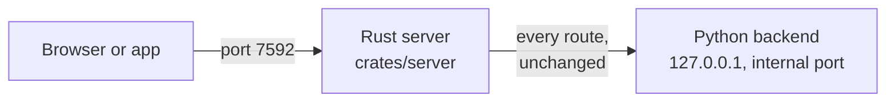

# Rust backend

The backend moves from Python to Rust one route at a time (roadmap, section 5). This document describes the state of
that port and the rules for continuing it.

## Request flow



The `ferrofolio` binary is the entry point of the server image. It first takes the public port, then binds a loopback
socket for the Python backend, starts Python as a child process that serves that socket (`--socket-fd`), and waits
until Python has answered an HTTP request on it. Only then does it listen on the public port; connections made
earlier are refused, as by the Python server. Because the gateway created the backend socket and only the child
holds it, no other process can answer in Python's place. No route is served by Rust yet; the calculators follow as
the first ported routes.

- **Forwarding.** Method, path, query, body and headers, including `Host`, `Authorization` and `X-Forwarded-*`, reach
  Python unchanged. Hop-by-hop headers are removed and the client address is appended to `X-Forwarded-For`, which
  uvicorn trusts from the loopback interface; a body without a known length is sent on with chunked framing, whatever
  the method. Responses are streamed, so long fetches, downloads and the MCP endpoint keep working. If Python cannot
  be reached the server answers `502` with the code `BACKEND_UNAVAILABLE`. Responses to login and signup carry a
  session token and get `Cache-Control: no-store`.
- **Lifecycle.** `SIGTERM` or `SIGINT` stops the public server, gives open requests three seconds, then sends
  `SIGTERM` to Python and kills it after six more seconds, which stays within Docker's default stop timeout of ten
  seconds. If Python exits on its own, the server exits with an error; with a restart policy such as the
  `unless-stopped` of the example compose file, Docker starts both again, otherwise the container stays stopped until
  someone restarts it.
- **Options.** The server accepts the options of `finanze/args.py` and passes them on, except that `--port` cannot be
  `0`: Python builds redirect URLs with that port. `--log-level NONE` silences the server's console output entirely.
  Python is started with the inherited socket, `--host 127.0.0.1`, its port and `--public-port <public port>`, which
  keeps the redirect URLs it builds for GoCardless and the ChatGPT sign-in on the public port. Additional settings:

| Variable / option | Default | Meaning |
|---|---|---|
| `FERROFOLIO_BACKEND_PORT` / `--backend-port` | `0` (a free port) | Loopback port for the Python backend |
| `FERROFOLIO_PYTHON` / `--python` | `python3` | Interpreter that starts the backend |
| `FERROFOLIO_BACKEND_APP` / `--backend-app` | `finanze` | Path of the Python package |

Startup keeps Python's behaviour of refusing connections until the backend is ready: the public address is bound
first but listens only then. Two servers started at the same time on the same address can therefore both start
their backend before the second fails to listen, as two Python servers could before; separate containers do not
share addresses.

## Crates

| Crate | Python counterpart | Content |
|---|---|---|
| `core-domain` | `finanze/domain` | `Dezimal`, domain types and errors as they are needed |
| `server` | `finanze/infrastructure/controller`, `server.py` | Forwarding to Python and its process management |

`Dezimal` reproduces Python's `decimal` arithmetic in its default context: every result of `+ - * /` is the exact
result rounded to 28 significant digits with `ROUND_HALF_EVEN`, and integer powers follow libmpdec. Values below
10^-999999 become subnormal and keep fewer digits, down to the smallest one, 10^-1000026; a result of at most half
of that rounds to zero, as in Python. A decimal with a bounded scale such as
`rust_decimal` (at most 28 decimal places and a 96-bit coefficient) cannot reproduce 28 significant digits in
general: `150 × (0.01 / 12)` is 0.125 in Python, rounded to cents with `ROUND_HALF_UP` that is 0.13, while
`rust_decimal` cut `0.01 / 12` at 28 decimal places, got a product just below 0.125 and rounded it to 0.12.
Its operators return a `Checked` value that carries a decimal signal (overflow, division by zero, invalid
operation) through a whole formula instead of panicking; the formula is unwrapped once with `value()`. Amounts
become `f64` only when a response is serialised, because the API carries them as JSON numbers.

Amounts are parsed exactly from their text. Strings follow Python's `Decimal(str)`: surrounding whitespace, every
underscore and digits of any script are accepted. Amounts keep up to 38 significant digits; a longer one is rejected
rather than rounded, because rounding it could change a cent.

## Parity tests

`tests/parity/generate_decimal_fixtures.py` records thousands of operations from Python's `decimal`, and
`crates/core-domain/tests/decimal_parity.rs` requires the same results. The table of Unicode digits that the parser
accepts is generated from Python's Unicode database by `tests/parity/generate_unicode_tables.py`. CI runs both
generators with `--check` in the Python job, so neither can drift from the Python version the backend uses.

```sh
python tests/parity/generate_decimal_fixtures.py --output crates/core-domain/tests/fixtures/decimal_parity.json
python tests/parity/generate_unicode_tables.py --write
```

## Running locally

```sh
cargo run --bin ferrofolio -- --port 7592 --data-dir .storage --log-dir .storage/logs --log-level DEBUG
```

The server starts `python3 finanze` from the repository root; set `FERROFOLIO_PYTHON` to the interpreter of the
virtual environment if needed.

## Next steps

1. The calculators as the first ported routes, with parity fixtures recorded from the Python routes.
2. `infra-db`: open existing SQLCipher databases with `rusqlite` and read the migration state.
