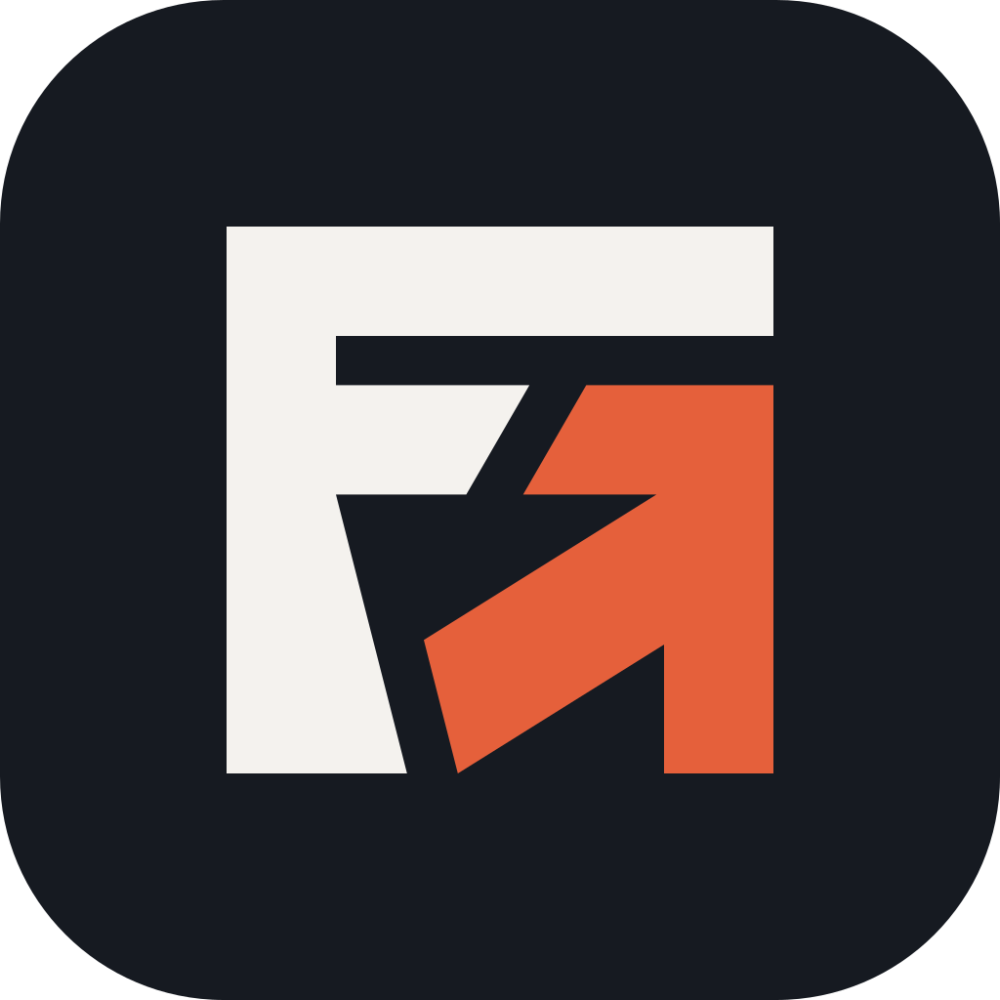
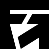

# Ferrofolio logo

 

The mark is an angular "F" and a return arrow (↗) that interlock into a square. The arrowhead sits on the row of
the F's middle arm, and the two are separated by a cut at 60°. The arrowhead's vertical leg runs down to the
baseline and closes the right side of the square. The stem widens towards the foot, and the arrow's shaft rises at
32° from the foot of the stem, its end cut parallel to the stem's edge. All corners are sharp and all gaps have the
same width, so the mark stays legible down to 16 px.

## Colours

Flat fills only, no gradients, at most three colours per file.

| Name | Hex       | Use                                            |
| ---- | --------- | ---------------------------------------------- |
| Ink  | `#161A21` | Background                                     |
| Bone | `#F4F2EE` | The F                                          |
| Rust | `#E5603B` | The return arrow. Iron oxide, a nod to "ferro" |

## Files

| File                                          | Content                                                                                                                                                                                            |
| --------------------------------------------- | -------------------------------------------------------------------------------------------------------------------------------------------------------------------------------------------------- |
| `ferrofolio-logo-mono.svg`                    | Mark in one colour (`currentColor`: inherits the text colour when inlined, black in ``)                                                                                                       |
| `ferrofolio-logo-color.svg`                   | Mark on a rounded tile, three colours                                                                                                                                                              |
| `ios/app-icon.svg`, `ios/app-icon-tinted.svg` | Sources of the iOS app icon, 1024 × 1024, full bleed, square corners                                                                                                                               |
| `macos/app-icon.svg`                          | Source of the macOS app icon, 1024 × 1024, on the macOS icon grid (rounded tile, transparent margin)                                                                                               |
| `ios/AppIcon.appiconset/`                     | Asset catalog for Xcode 16 and later: one 1024 px icon each for the default, dark and tinted appearance. Default and dark are identical; the dark entry is explicit so iOS does not derive its own |
| `ios/icon-composer/{f,arrow}.svg`             | Foreground layers for Icon Composer (iOS 26 and later)                                                                                                                                             |
| `ios/apple-touch-icon.png`                    | 180 × 180 home screen icon for the web app (PWA)                                                                                                                                                   |

## iOS notes

- The icons are square and opaque, and the PNGs have no alpha channel, as the App Store requires. iOS applies the
  rounded mask itself.
- The mark is a 560 px square, 55 % of the canvas, centred inside the safe area of the mask.
- The colour icon (Ink background) is used in light and dark mode. The tinted icon is white on black; iOS replaces
  the white with the tint colour.
- For Icon Composer, import `f.svg` and `arrow.svg` as two layers, set the background to a solid Ink fill and keep
  layer fills flat. The glass highlights are drawn by the system.

## Export

The PNGs are rendered from the SVG sources with librsvg and ImageMagick:

```bash
rsvg-convert -w 1024 -h 1024 ios/app-icon.svg | magick png:- -alpha off -strip PNG24:ios/AppIcon.appiconset/AppIcon-1024.png
cp ios/AppIcon.appiconset/AppIcon-1024.png ios/AppIcon.appiconset/AppIcon-1024-dark.png
rsvg-convert -w 1024 -h 1024 ios/app-icon-tinted.svg | magick png:- -alpha off -strip PNG24:ios/AppIcon.appiconset/AppIcon-1024-tinted.png
rsvg-convert -w 180 -h 180 ios/app-icon.svg | magick png:- -alpha off -strip PNG24:ios/apple-touch-icon.png
```

The web app uses rendered copies as well, and `ferrofolio-macos.icns` is built from the macOS source. From the
repository root:

```bash
rsvg-convert -w 1024 -h 1024 resources/logo/ios/app-icon.svg -o frontend/app/public/ferrofolio-app.png
rsvg-convert -w 1024 -h 1024 frontend/app/public/ferrofolio-fg.svg -o frontend/app/public/ferrofolio-fg.png

tmp=$(mktemp -d)
for s in 16 32 48 128 256 512 1024; do rsvg-convert -w "$s" -h "$s" resources/logo/macos/app-icon.svg -o "$tmp/icon_$s.png"; done
png2icns frontend/app/public/ferrofolio-macos.icns "$tmp"/icon_{16,32,48,128,256,512,1024}.png
```
